# Lab 04 - Product Manager

**Học phần:** COMP1019 - Lập trình trên Windows
**Buổi 4:** Exception, Delegate/Event, Func/Action và Generic trong C#

Chương trình Console quản lý sản phẩm, dữ liệu lưu trong bộ nhớ bằng `Repository<T>`.

## Công nghệ

- C# / .NET 10 (Console App)
- Visual Studio 2022+

## Cách chạy

1. Clone repo về máy.
2. Mở file `Lab04_PRODUCT_MANAGER.slnx` bằng Visual Studio.
3. Nhấn `F5` (hoặc `Ctrl + F5`) để chạy.

## Cấu trúc project

| File | Vai trò |
|---|---|
| `IEntity.cs` | Interface `IEntity` (`string Id { get; }`), dùng làm ràng buộc generic |
| `Product.cs` | Lớp sản phẩm: `MaSP`, `TenSP`, `Price`, `Quantity`. Price và Quantity không được âm |
| `DuplicateProductException.cs` | Exception tự tạo, phát sinh khi thêm sản phẩm trùng mã |
| `ProductNotFoundException.cs` | Exception tự tạo, phát sinh khi tìm/xóa sản phẩm không tồn tại |
| `Repository_T.cs` | Generic class `Repository<T> where T : IEntity`: `Add`, `Remove`, `FindById`, `Find(Func<T,bool>)`, `GetAll` |
| `ProductService.cs` | Xử lý nghiệp vụ, gọi Repository, phát event khi thêm/xóa thành công |
| `Program.cs` | Menu, nhập xuất dữ liệu, bắt exception |

## Chức năng

| Lựa chọn | Chức năng |
|---|---|
| 1 | Thêm sản phẩm (mã không rỗng, không trùng) |
| 2 | Xuất danh sách (thông báo nếu rỗng) |
| 3 | Tìm theo mã |
| 4 | Tìm theo tên (chứa từ khóa, không phân biệt hoa thường) |
| 5 | Lọc theo khoảng giá (dùng `Func<Product, bool>`) |
| 6 | Xóa sản phẩm (phát event khi xóa thành công) |
| 7 | Tính tổng giá trị kho (đơn giá × số lượng) |
| 0 | Thoát |

## Các kỹ thuật đã áp dụng

- **Exception:** 2 exception tự tạo (`DuplicateProductException`, `ProductNotFoundException`), kết hợp `try-catch` trong `Program` để chương trình không bị dừng đột ngột khi nhập sai.
- **Event:** `ProductAdded` và `ProductRemoved` (kiểu `Action<Product>`) trong `ProductService`, được đăng ký ở `Program` để in thông báo `[EVENT]`.
- **Func:** `Func<Product, bool>` dùng trong tìm theo tên và lọc theo khoảng giá.
- **Generic:** `Repository<T>` với ràng buộc `where T : IEntity`.
- **Tách lớp:** nghiệp vụ nằm ở `ProductService`, lưu trữ nằm ở `Repository<T>`, `Program` chỉ điều khiển menu và nhập xuất.

## Ảnh chụp màn hình

### Giao diện chính

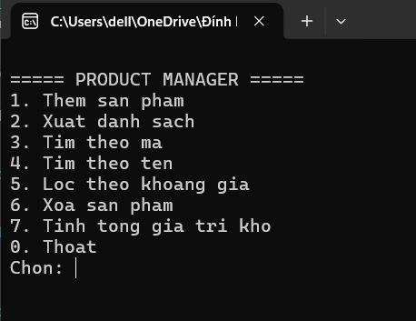

### 1. Thêm sản phẩm
Thêm sản phẩm thành công
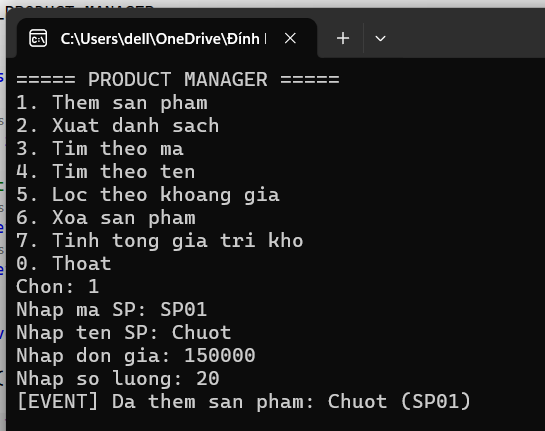
Thêm sản phẩm trùng mã 
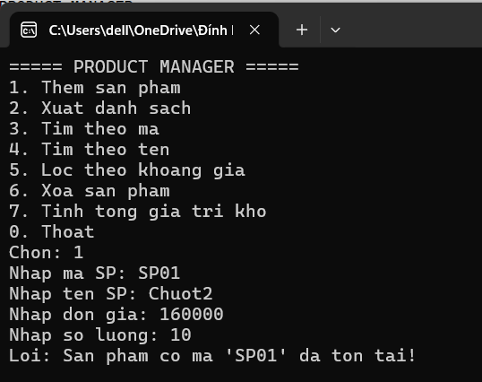
Thêm sản phẩm mã rỗng 
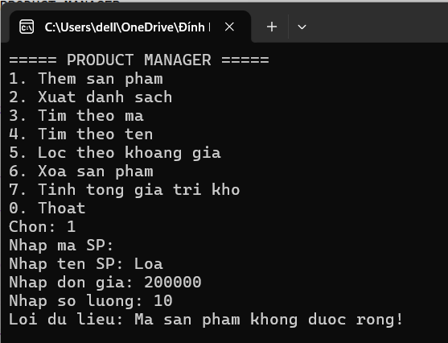
Thêm sản phẩm giá âm 
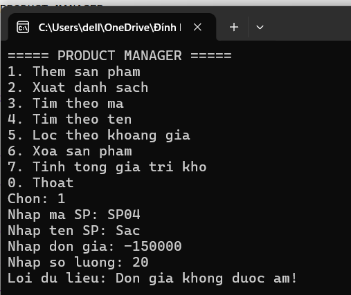
Lỗi giá không hợp lệ
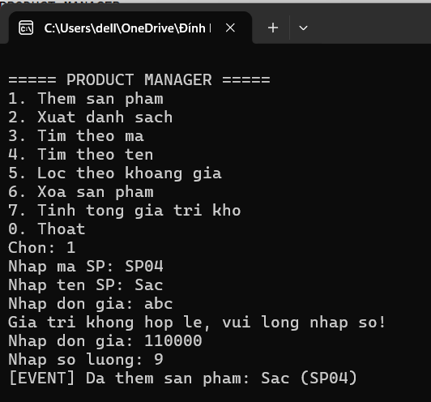
Lỗi số lượng âm
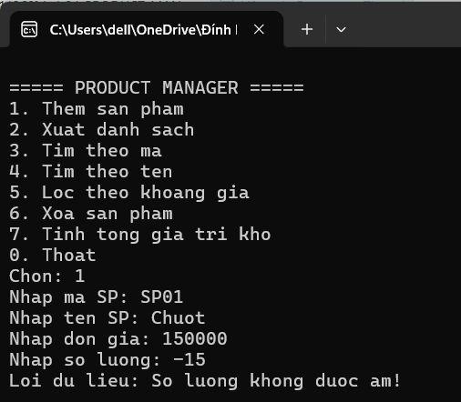

### 2. Xuất danh sách

Danh sách rỗng
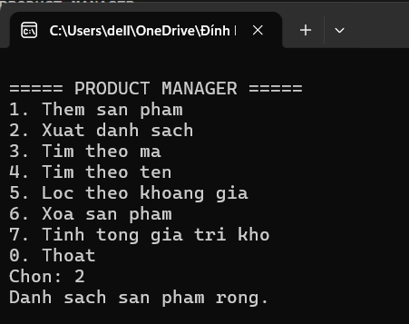
Danh sách đầy đủ
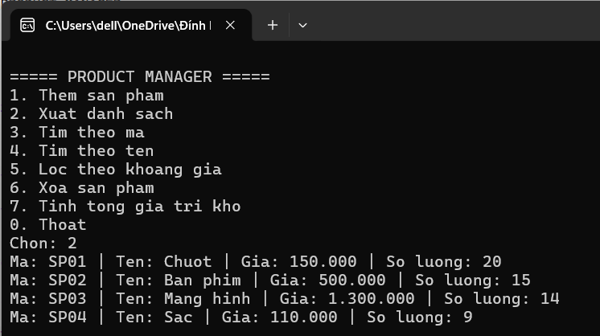

### 3. Tìm theo mã

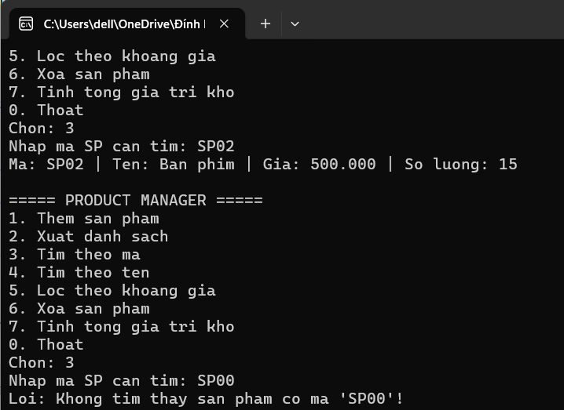

### 4. Tìm theo tên

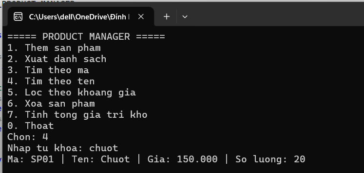

### 5. Lọc theo khoảng giá
Lọc theo khoảng giá thành công
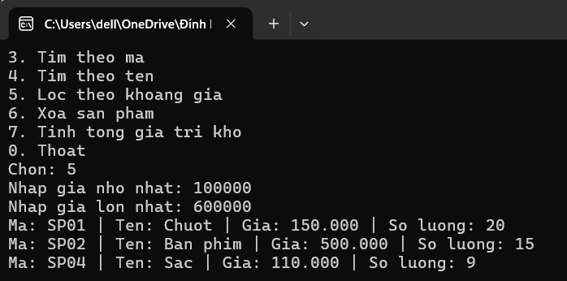

Lỗi khoảng giá không hợp lệ
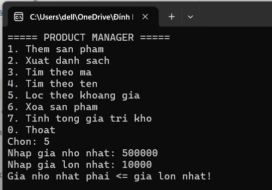

### 6. Xóa sản phẩm
Xóa sản phẩm thành công
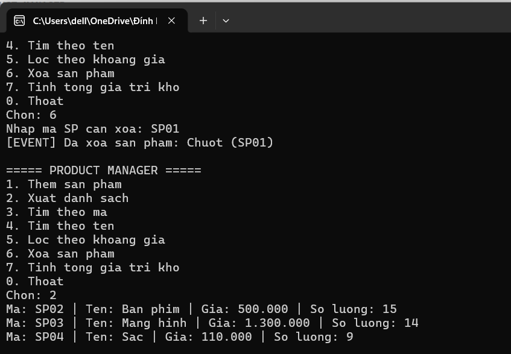
Xóa sản phẩm không tồn tại
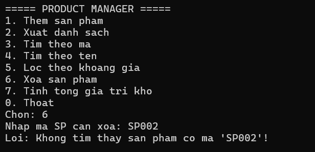

### 7. Tính tổng giá trị kho
Trước khi xóa sản phẩm
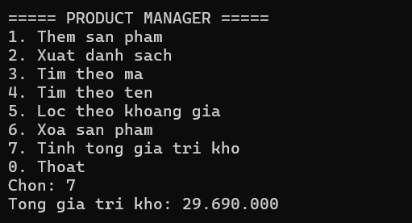
Sau khi xóa sản phẩm
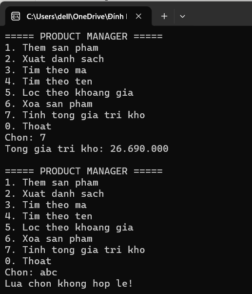

### 8. Thoát chương trình
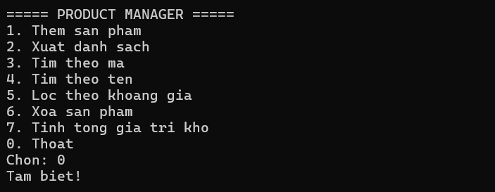