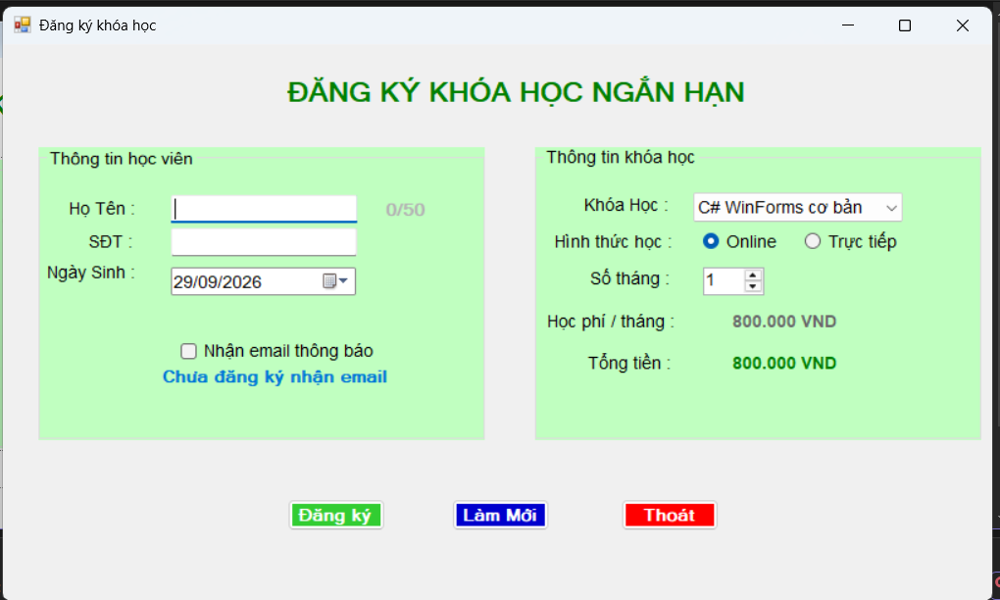
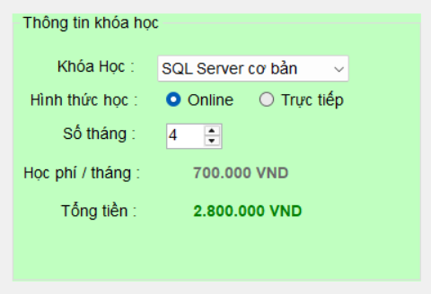
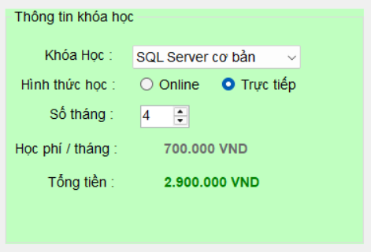
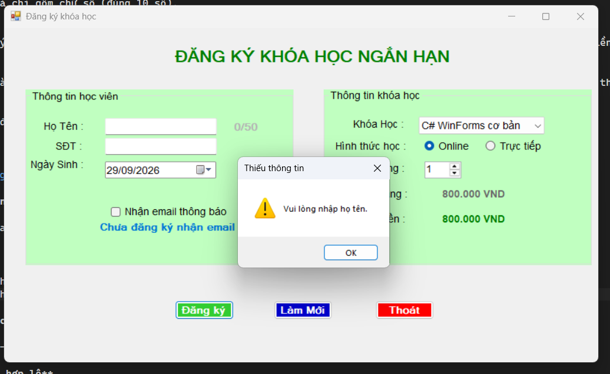
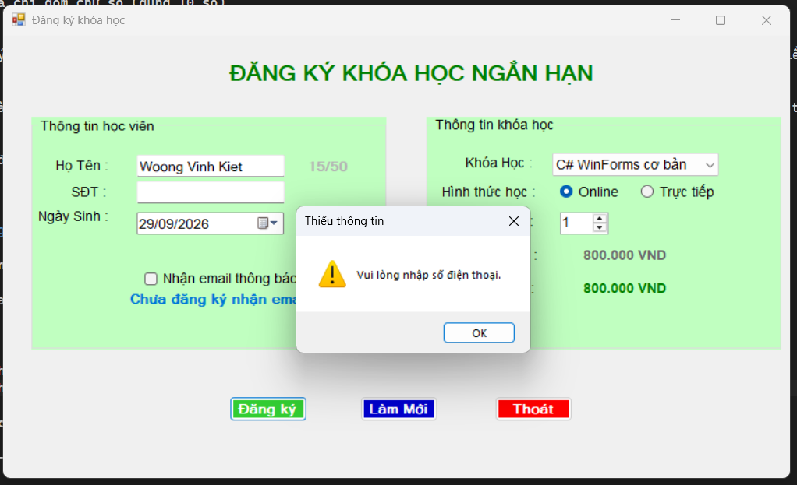
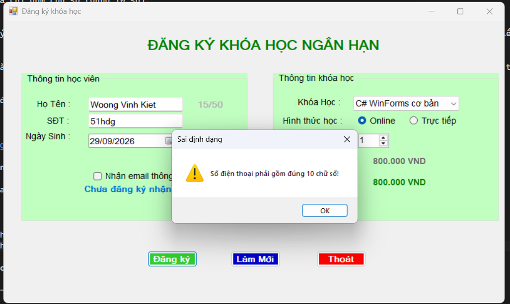
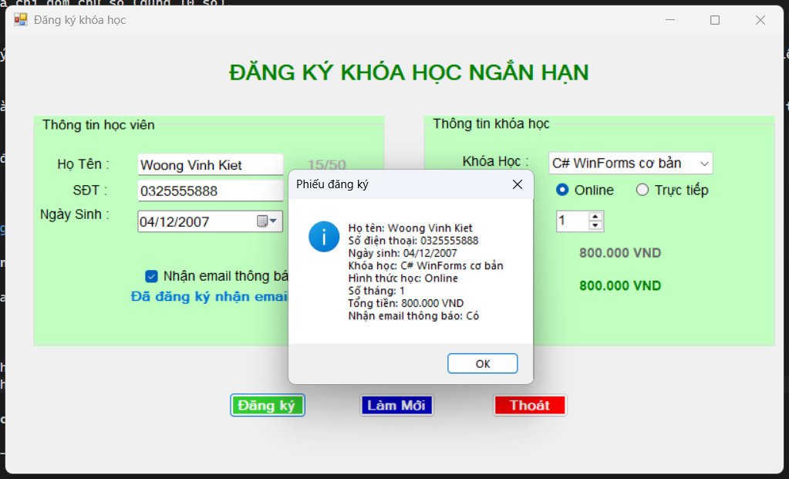
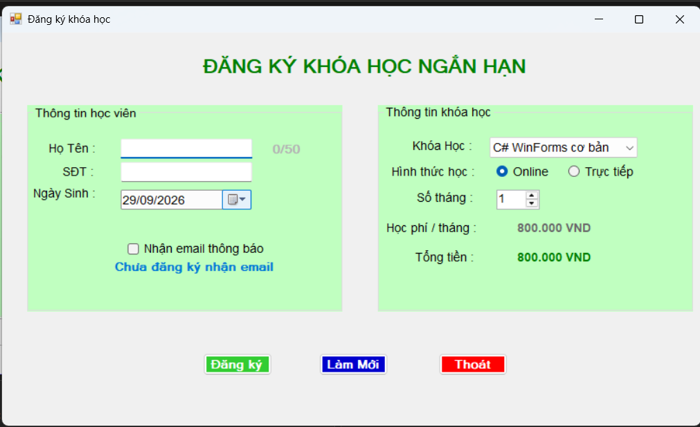
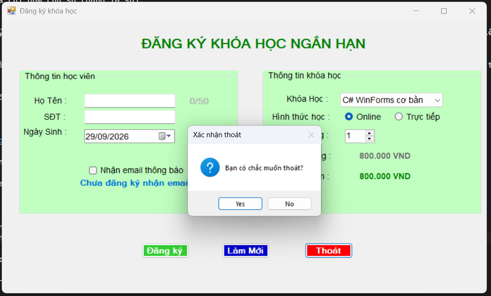

# CourseRegistrationApp - Ứng dụng đăng ký khóa học

## 1. Giới thiệu

Ứng dụng Windows Forms (C#) dùng để đăng ký khóa học. Người dùng nhập thông tin học viên, chọn khóa học, hình thức học và số tháng; ứng dụng tự tính tổng học phí và hiển thị phiếu đăng ký bằng `MessageBox`. Ứng dụng chỉ xử lý dữ liệu trên Form, chưa lưu cơ sở dữ liệu.

## 2. Công nghệ sử dụng

- Ngôn ngữ: C#
- Nền tảng: .NET Framework, Windows Forms App
- IDE: Visual Studio

## 3. Các control sử dụng

| Nhóm | Control | Tên control | Chức năng |
|---|---|---|---|
| Thông tin học viên | TextBox | `txtHoTen` | Nhập họ tên (tối đa 50 ký tự, có bộ đếm ký tự) |
| Thông tin học viên | TextBox | `txtSoDienThoai` | Nhập số điện thoại (chỉ cho nhập số) |
| Thông tin học viên | DateTimePicker | `dtpNgaySinh` | Chọn ngày sinh (không quá ngày hiện tại) |
| Thông tin học viên | CheckBox | `chkNhanEmail` | Nhận email thông báo |
| Thông tin khóa học | ComboBox | `cboKhoaHoc` | Chọn khóa học |
| Thông tin khóa học | RadioButton | `radOnline` | Hình thức Online |
| Thông tin khóa học | RadioButton | `radTrucTiep` | Hình thức Trực tiếp |
| Thông tin khóa học | NumericUpDown | `numSoThang` | Số tháng đăng ký (1 - 12) |
| Thông tin khóa học | Label | `lblHocPhi` | Hiển thị học phí / tháng |
| Thông tin khóa học | Label | `lblTien` | Hiển thị tổng học phí |
| Nút lệnh | Button | `btnDangKy` | Đăng ký |
| Nút lệnh | Button | `btnLamMoi` | Làm mới dữ liệu |
| Nút lệnh | Button | `btnThoat` | Thoát chương trình |

> Các control được gom vào hai `GroupBox`: **Thông tin học viên** và **Thông tin khóa học**.

## 4. Dữ liệu khóa học

| Khóa học | Học phí / tháng |
|---|---|
| C# WinForms cơ bản | 800.000 VNĐ |
| SQL Server cơ bản | 700.000 VNĐ |
| Web Frontend cơ bản | 750.000 VNĐ |
| Lập trình Python cơ bản | 650.000 VNĐ |

**Công thức tính tổng học phí:**

```
Tổng tiền = Học phí 1 tháng x Số tháng (+ 100.000 VNĐ phụ phí nếu học trực tiếp)
```

## 5. Chức năng

### 5.1. Khi Form Load
- Nạp danh sách khóa học vào ComboBox và chọn mặc định khóa đầu tiên.
- Chọn mặc định hình thức Online.
- Thiết lập số tháng tối thiểu 1, tối đa 12.
- Hiển thị học phí / tháng và tổng học phí ban đầu.

### 5.2. Tính học phí tự động
Tổng tiền được tính lại ngay khi người dùng đổi khóa học, đổi hình thức học hoặc đổi số tháng (các sự kiện `SelectedIndexChanged`, `CheckedChanged`, `ValueChanged`).

### 5.3. Nút Đăng ký
Kiểm tra dữ liệu trước khi xử lý:
- Họ tên không được rỗng.
- Số điện thoại không được rỗng và chỉ gồm chữ số (đúng 10 số).
- Phải chọn khóa học.

Nếu hợp lệ, hiển thị phiếu đăng ký bằng `MessageBox` gồm: họ tên, số điện thoại, ngày sinh, khóa học, hình thức học, số tháng, tổng tiền và trạng thái nhận email.

### 5.4. Nút Làm mới
Xóa họ tên, số điện thoại; đưa ngày sinh về ngày hiện tại; bỏ chọn nhận email; chọn lại khóa học đầu tiên và hình thức Online; đưa số tháng về 1; đưa con trỏ về ô họ tên.

### 5.5. Nút Thoát
Hiển thị hộp thoại xác nhận, chỉ đóng Form khi người dùng chọn **Yes**.

## 6. Hình ảnh minh họa

> Ảnh được đặt trong thư mục `images/` của repo.

**Giao diện khi mới mở chương trình**



**Tổng tiền thay đổi khi đổi khóa học / số tháng / hình thức học**




**Báo lỗi khi bỏ trống họ tên hoặc số điện thoại**




**Báo lỗi khi số điện thoại không hợp lệ**



**Phiếu đăng ký**



**Sau khi bấm Làm mới**



**Hộp thoại xác nhận khi bấm Thoát**



## 7. Tự đánh giá

| Tiêu chí | Trạng thái |
|---|---|
| Tạo đúng project và Form chạy được | Hoàn thành |
| Giao diện đủ control, bố cục rõ ràng | Hoàn thành |
| Đặt tên control đúng quy ước | Hoàn thành |
| Nạp dữ liệu khóa học khi Form Load | Hoàn thành |
| Tính học phí đúng khi thay đổi khóa học / số tháng | Hoàn thành |
| Nút Đăng ký kiểm tra dữ liệu và hiển thị kết quả | Hoàn thành |
| Nút Làm mới và Thoát | Hoàn thành |
| Code rõ ràng, dễ đọc | Hoàn thành |