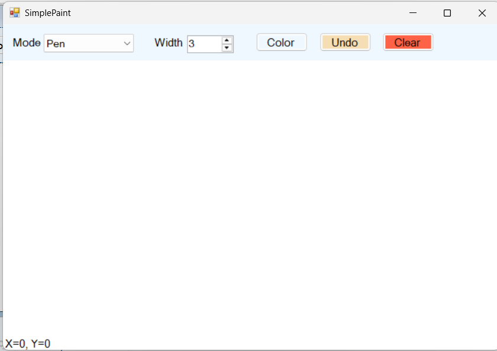
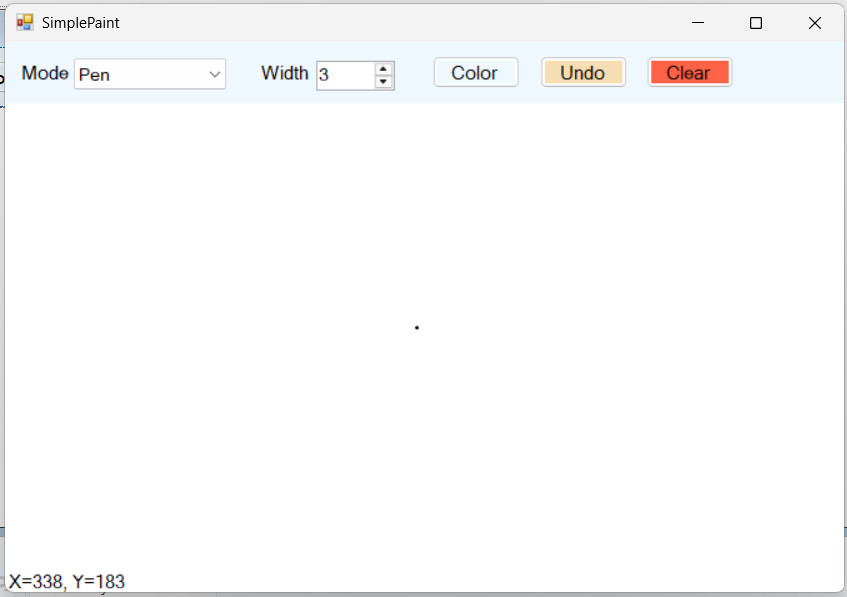
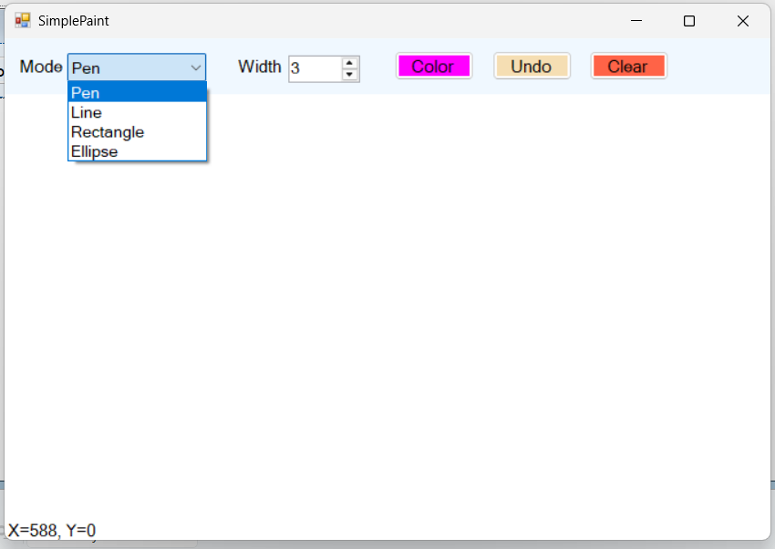
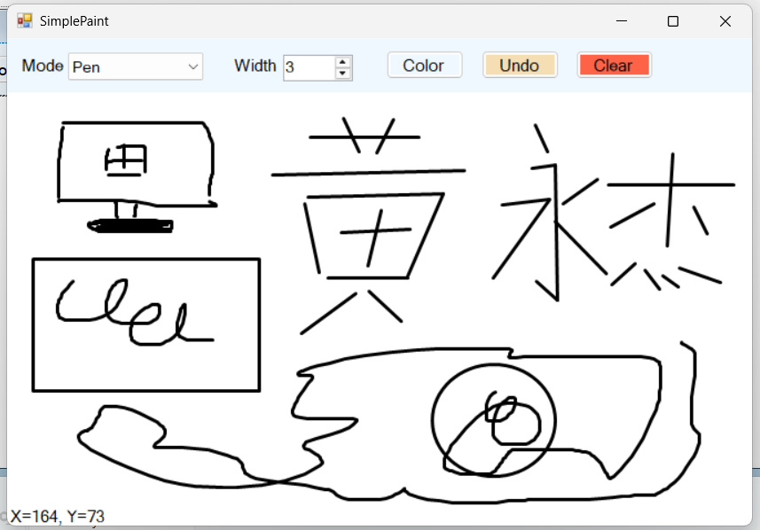
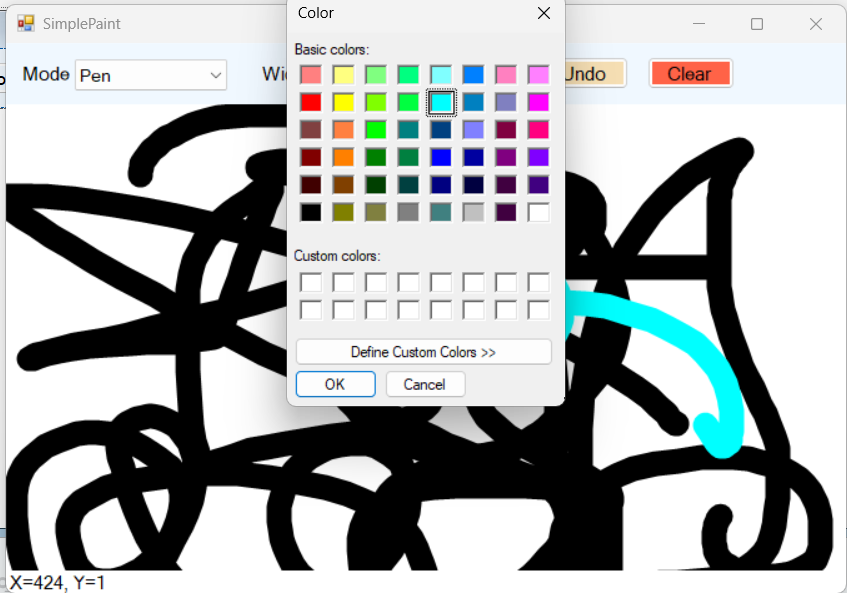
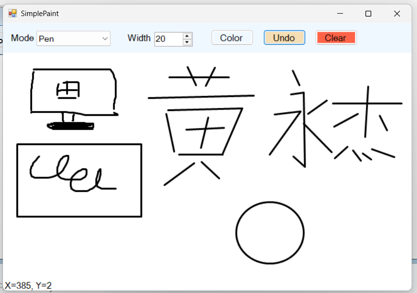
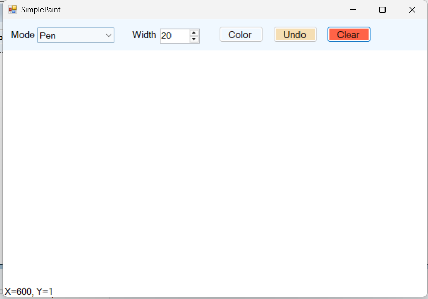

# COMP1019 - Lab 08: Simple Paint

Ứng dụng Paint đơn giản xây dựng bằng **C# Windows Forms** và **GDI+**.
Người dùng chọn chế độ vẽ, màu, độ dày nét rồi vẽ trực tiếp lên vùng canvas bằng chuột.

## Công nghệ

- Ngôn ngữ: C#
- Nền tảng: Windows Forms (.NET Framework)
- Công cụ: Visual Studio

## Cách chạy chương trình

1. Clone hoặc tải project về máy.
2. Mở file `Lab08_SimplePaint.sln` bằng Visual Studio.
3. Chọn **Build → Rebuild Solution**.
4. Nhấn **F5** (hoặc nút **Start**) để chạy.

## Cách sử dụng

1. Chọn chế độ vẽ ở ô **Mode**: Pen, Line, Rectangle hoặc Ellipse.
2. Chọn độ dày nét ở ô **Width** (từ 1 đến 20).
3. Bấm nút **Color** để chọn màu.
4. Nhấn giữ **chuột trái** trên vùng trắng và kéo để vẽ, thả chuột để kết thúc nét.
5. Bấm **Undo** (hoặc phím **Ctrl+Z**) để xóa nét vẽ gần nhất.
6. Bấm **Clear** để xóa toàn bộ vùng vẽ.
7. Tọa độ chuột hiện ở dòng chữ phía dưới cùng của cửa sổ.

## Chức năng đã làm

| Chức năng | Trạng thái |
|---|---|
| Vẽ tự do (Pen) | Có |
| Vẽ đường thẳng (Line) | Có |
| Vẽ hình chữ nhật (Rectangle), kéo chuột theo mọi hướng | Có |
| Vẽ hình ellipse (Ellipse), kéo chuột theo mọi hướng | Có |
| Chọn màu bằng ColorDialog | Có |
| Chọn độ dày nét bằng NumericUpDown (1 đến 20) | Có |
| Nút Clear | Có |
| Nút Undo | Có |
| Hiển thị tọa độ chuột | Có |
| Nét vẽ không mất khi resize hoặc che Form | Có |
| Phím tắt Ctrl+Z (nâng cao) | Có |

## Cách hoạt động

- Mỗi nét vẽ được lưu thành một đối tượng `DrawItem` (chế độ, màu, độ dày, điểm đầu, điểm cuối, danh sách điểm).
- Các nét đã vẽ xong nằm trong `List<DrawItem> items`.
- Các sự kiện `MouseDown`, `MouseMove`, `MouseUp` chỉ ghi nhận dữ liệu, sau đó gọi `canvas.Invalidate()`.
- Việc vẽ được thực hiện trong sự kiện `Paint` của canvas: duyệt qua danh sách `items` và vẽ lại từng nét.
  Nhờ vậy hình không bị mất khi Form resize hoặc bị che.
- Hàm `GetRectangle` dùng `Math.Min` và `Math.Abs` để vẽ đúng hình chữ nhật và ellipse khi kéo chuột theo bất kỳ hướng nào.
- `Pen` và `Brush` tự tạo đều được đặt trong `using` để giải phóng tài nguyên.

## Cấu trúc project

```
Lab08_SimplePaint/
├── Form1.cs            # Xử lý chuột, vẽ lại, các nút, DrawMode, DrawItem
├── Form1.Designer.cs   # Giao diện (sinh bởi Visual Studio)
├── Program.cs          # Điểm khởi chạy ứng dụng
└── README.md
```

## Ảnh chụp màn hình

### Giao diện chính



### Đổi tọa độ chuột



### CHọn chế độ vẽ



### Vẽ thử Pen, Line, Rectangle, Ellipse



### Đổi màu



### Undo và Clear






