# Lab 09 - Thiết kế và in thẻ sinh viên (WinForms)

Ứng dụng Windows Forms nhập thông tin sinh viên, chọn ảnh, xem trước thẻ bằng GDI+ và in thẻ qua `PrintDocument`.

## Cách chạy

**Cách 1 - Visual Studio 2022**
1. Mở file `Lab09_TheSinhVien.csproj`.
2. Nhấn `F5` để chạy.

**Cách 2 - dòng lệnh** (cần .NET 8 SDK trên Windows)
```
dotnet run --project Lab09_TheSinhVien.csproj
```

> Nếu dùng .NET Framework 4.x: tạo project Windows Forms App mới tên `Lab09_TheSinhVien`, chép đè `Program.cs`, `StudentCardInfo.cs`, `FrmStudentCard.cs`, `FrmStudentCard.Designer.cs`.

## Cách dùng
1. Nhập **Mã sinh viên**, **Họ và tên** (bắt buộc), chọn Lớp, Khoa, Khóa học, Ngày sinh, Giới tính.
2. Bấm **Chọn ảnh...** để chọn ảnh JPG/PNG/BMP.
3. Thẻ hiển thị ở vùng **Xem trước thẻ sinh viên** và tự cập nhật khi dữ liệu đổi.
4. Bấm **Xem trước in** để mở Print Preview, hoặc **In thẻ** để chọn máy in.
5. **Làm mới** đưa Form về trạng thái ban đầu.

## Bảng đặt tên control

| Control | Tên | Kiểu |
|---|---|---|
| Form chính | `FrmStudentCard` | Form |
| Nhóm thông tin | `grpThongTin` | GroupBox |
| Mã sinh viên | `lblMaSV`, `txtMaSV` | Label, TextBox |
| Họ tên | `lblHoTen`, `txtHoTen` | Label, TextBox |
| Lớp | `lblLop`, `cboLop` | Label, ComboBox |
| Khoa | `lblKhoa`, `cboKhoa` | Label, ComboBox |
| Khóa học | `lblKhoaHoc`, `cboKhoaHoc` | Label, ComboBox |
| Ngày sinh | `lblNgaySinh`, `dtpNgaySinh` | Label, DateTimePicker |
| Giới tính | `lblGioiTinh`, `cboGioiTinh` | Label, ComboBox |
| Nhóm ảnh | `grpAnh` | GroupBox |
| Ảnh đại diện | `picAnhDaiDien` | PictureBox (Zoom) |
| Nút chọn ảnh | `btnChonAnh` | Button |
| Hộp thoại chọn ảnh | `dlgChonAnh` | OpenFileDialog |
| Vùng xem trước | `grpXemTruoc`, `pnlXemTruoc` | GroupBox, Panel |
| Các nút | `btnLamMoi`, `btnXemTruocIn`, `btnIn`, `btnThoat` | Button |
| In ấn | `docInThe`, `dlgXemTruocIn`, `dlgIn` | PrintDocument, PrintPreviewDialog, PrintDialog |

## Cấu trúc code (bám theo slide Nội dung 9)

| Thành phần | Ý nghĩa | Slide |
|---|---|---|
| `StudentCardInfo` | Model lưu dữ liệu thẻ, dùng chung cho preview và in | 33 |
| `GetStudentInfo()` | Lấy dữ liệu từ Form đưa vào model | 34 |
| `LoadImageSafe()` | Copy ảnh sang `Bitmap`, `Dispose` ảnh cũ, không khóa file | 12 |
| `HasValidPhoto()`, `ValidateInput()` | Kiểm tra mã SV, họ tên, ảnh trước khi preview/in | 14, 24 |
| `docInThe.PrintPage += ...` | Gắn sự kiện một lần trong constructor, tránh vẽ lặp | 24 |
| `pnlXemTruoc_Paint` | Vẽ preview bằng GDI+, gọi `Invalidate()` khi dữ liệu đổi | 35 |
| `DrawStudentCard(g, card, info)` | Một hàm vẽ dùng chung cho preview và in | 36 |
| `DrawImageZoom()` | Vẽ ảnh giữ tỉ lệ (giống `SizeMode.Zoom`) | 37 |

Khi in, `PrintPage` đổi `PageUnit` sang `Pixel` rồi tính vùng thẻ theo DPI của máy in, nên chữ và ảnh có cùng kích thước ở Print Preview và bản in thật.

## Test case (đã tự kiểm thử)

| # | Test case | Bước thực hiện | Kết quả mong đợi | Kết quả |
|---|---|---|---|---|
| 1 | Mở chương trình | Chạy app | Form hiện đủ control, vùng preview hiện dòng hướng dẫn | Đạt |
| 2 | Thiếu mã SV | Bỏ trống MSSV, nhập tên, chọn ảnh, bấm Xem trước in | Báo "Vui lòng nhập mã sinh viên", focus vào `txtMaSV` | Đạt |
| 3 | Thiếu họ tên | Nhập MSSV, bỏ trống tên, bấm In thẻ | Báo "Vui lòng nhập họ và tên", không mở PrintDialog | Đạt |
| 4 | Thiếu ảnh | Nhập đủ MSSV và tên, không chọn ảnh, bấm Xem trước in | Báo "Vui lòng chọn ảnh đại diện" | Đạt |
| 5 | Chọn file không phải ảnh | Trong hộp thoại, đổi bộ lọc sang All files (nếu có) hoặc đổi tên file .txt thành .jpg | Báo lỗi "Không đọc được file ảnh", app không crash | Đạt |
| 6 | Preview cập nhật tức thì | Gõ tên, đổi lớp, khoa, ngày sinh, giới tính | Thẻ trên Panel đổi theo ngay | Đạt |
| 7 | Ảnh ngang và ảnh dọc | Chọn ảnh 16:9 rồi ảnh 3:4 | Ảnh trên thẻ giữ đúng tỉ lệ, có viền trắng, không méo | Đạt |
| 8 | Tên dài | Nhập họ tên 50 ký tự | Chữ bị cắt bằng dấu "..." trong khung, không tràn thẻ | Đạt |
| 9 | Print Preview | Nhập đủ dữ liệu, bấm Xem trước in | Mở PrintPreviewDialog, thẻ có khung, tiêu đề, ảnh, thông tin | Đạt |
| 10 | In ra máy in | Bấm In thẻ, chọn "Microsoft Print to PDF" | Có file PDF chứa thẻ, ảnh không méo | Đạt |
| 11 | Làm mới | Nhập dữ liệu, chọn ảnh, bấm Làm mới | Xóa dữ liệu, ảnh, preview về trạng thái ban đầu | Đạt |
| 12 | Ngày sinh tương lai | Mở lịch `dtpNgaySinh`, thử chọn ngày sau hôm nay | Không chọn được (`MaxDate` = hôm nay) | Đạt |
| 13 | Xác nhận thoát | Bấm Thoát | Hiện MessageBox hỏi có muốn thoát, chọn Yes thì app đóng | Đạt |

## Ảnh chụp màn hình
### 1. Mở chương trình

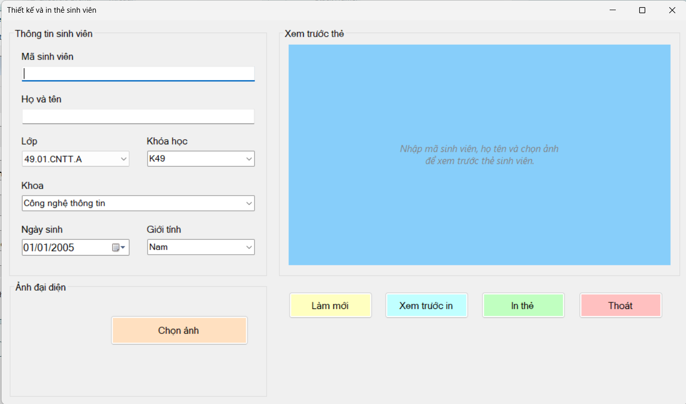

### 2. Thiếu mã SV

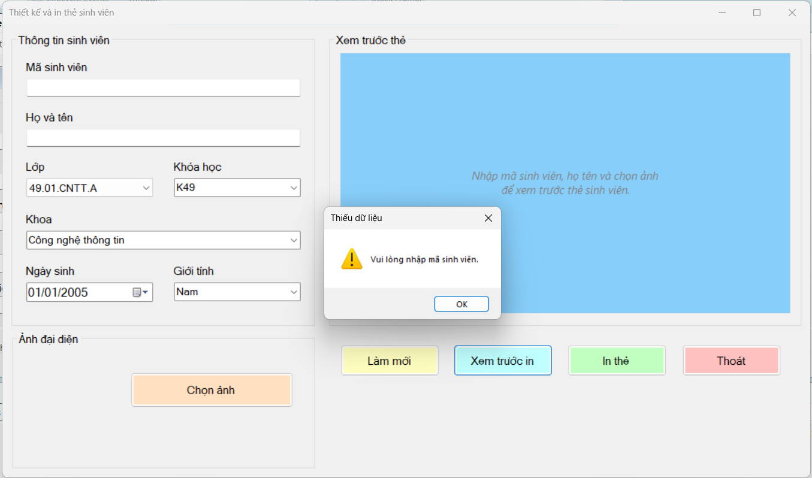

### 3. Thiếu họ tên

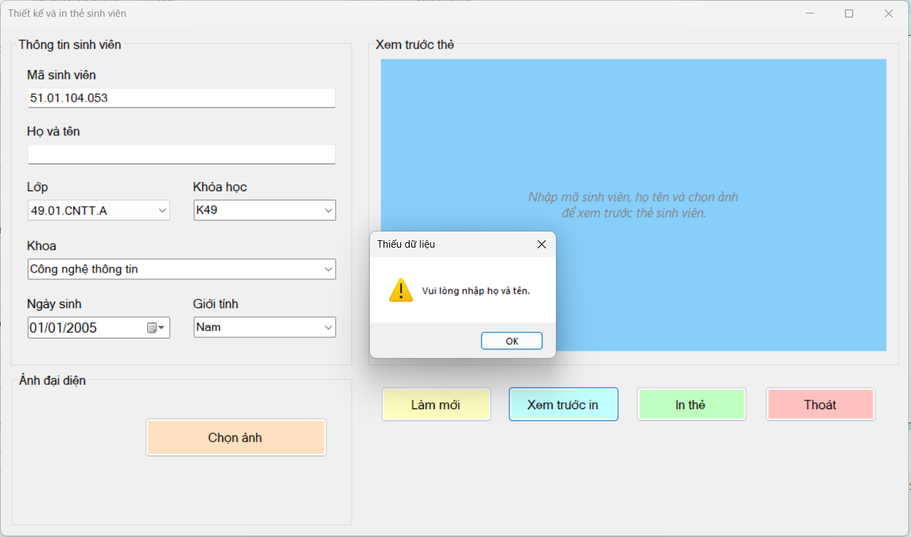

### 4. Thiếu ảnh


### 5. Chọn file không phải ảnh

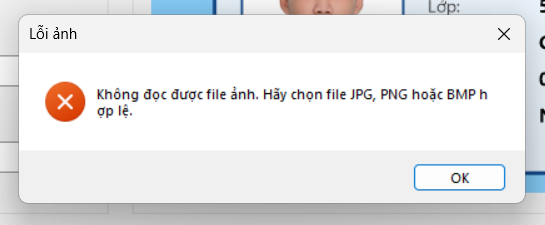

### 6. Preview cập nhật tức thì

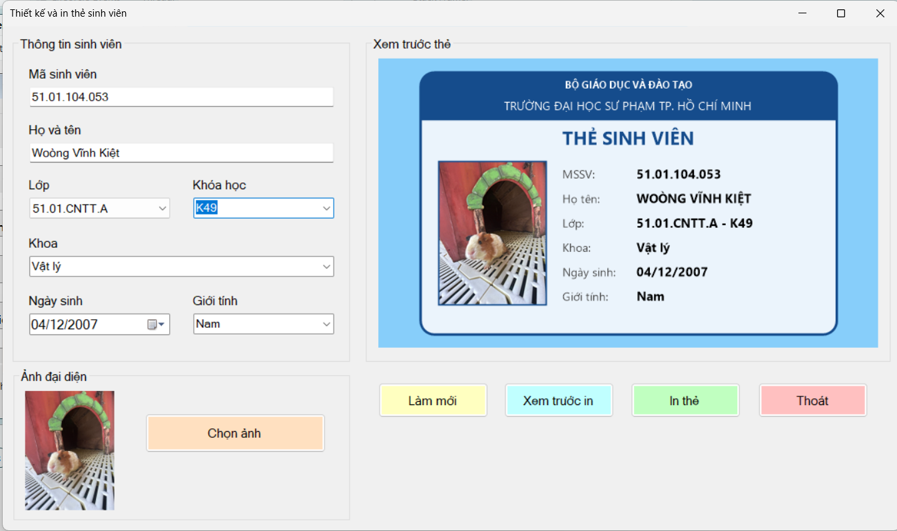

### 7. Ảnh ngang và ảnh dọc

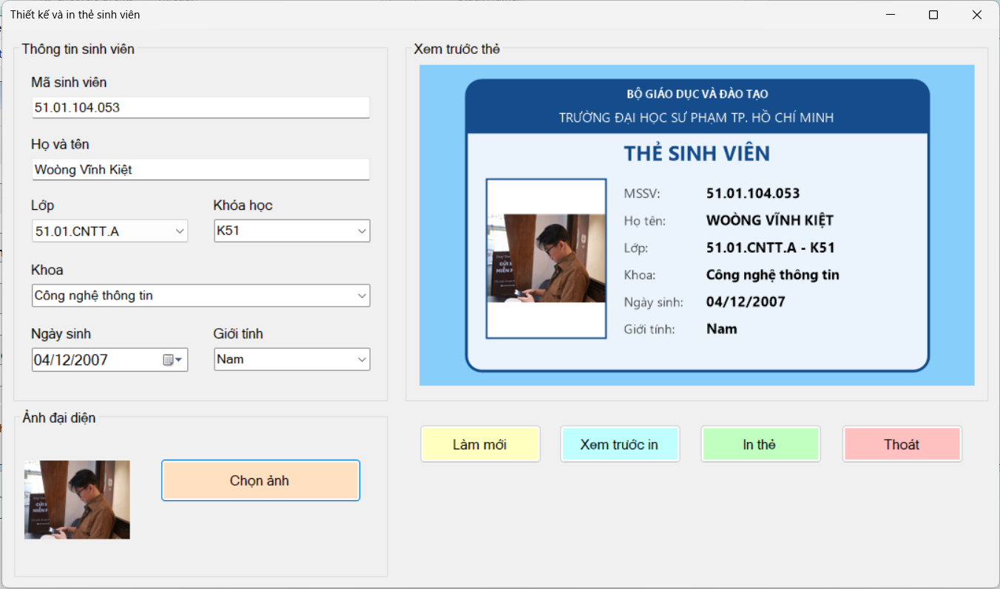

### 8. Tên dài

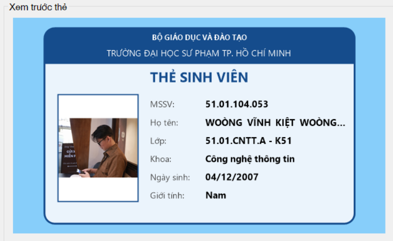

### 9. Print Preview

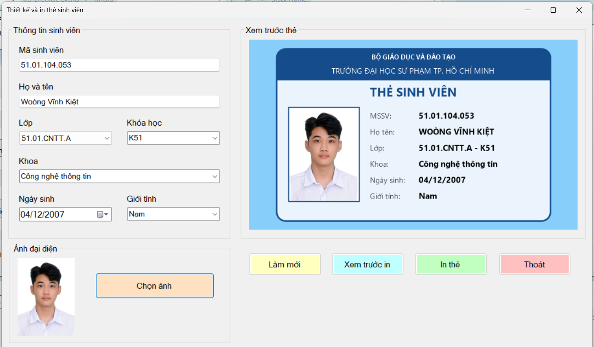

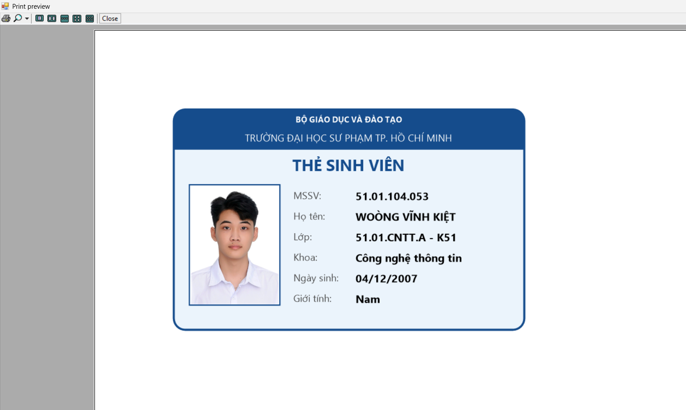

### 10. In ra máy in

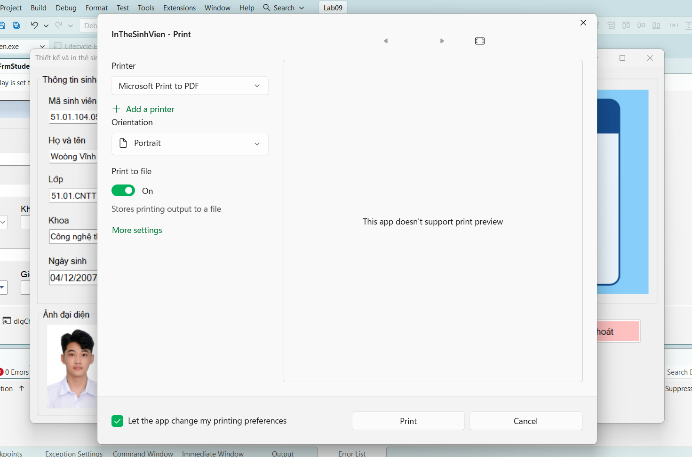

### 11. Làm mới

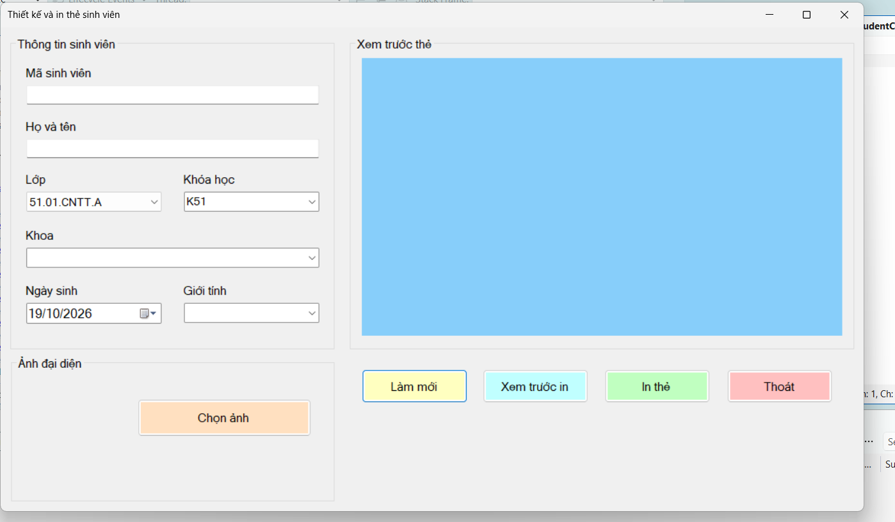

### 12. Ngày sinh tương lai

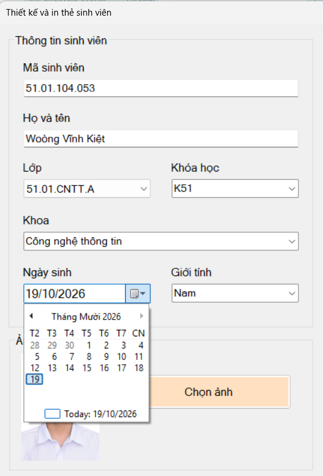

### 13. Xác nhận thoát

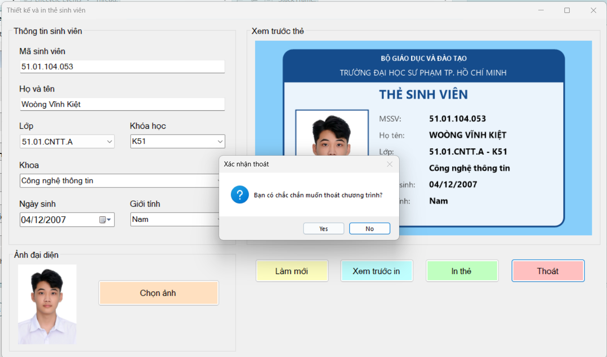
