# ShopManagerMini – Quản lý cửa hàng mini

**Môn học:** COMP1019 – Lập trình trên Windows
**Bài lab:** Buổi 7 – SDI, MDI và ứng dụng nhiều Form trong C# WinForms

## 1. Giới thiệu

Ứng dụng Windows Forms quản lý cửa hàng mini gồm nhiều Form: đăng nhập, Form chính dạng MDI, quản lý sản phẩm, quản lý khách hàng và giới thiệu. Dữ liệu lưu tạm trong bộ nhớ bằng `BindingList<T>` (chưa kết nối SQL Server), tắt chương trình thì dữ liệu quay về mặc định.

**Công nghệ:** C# WinForms, .NET Framework 4.7.2, Visual Studio.

## 2. Cách chạy

1. Mở file `ShopManagerMini.slnx` (hoặc `ShopManagerMini.csproj`) bằng Visual Studio.
2. Nhấn **F5** để Build và chạy.
3. Đăng nhập bằng một trong hai tài khoản mẫu bên dưới.

### Tài khoản mẫu

| Username | Password | Họ tên | Vai trò |
|---|---|---|---|
| admin | 123 | Quản trị viên | Admin |
| user | 123 | Nhân viên bán hàng | User |

## 3. Cấu trúc project

```
ShopManagerMini
|-- Models
|   |-- User.cs
|   |-- Product.cs
|   |-- Customer.cs
|
|-- Forms
|   |-- FrmLogin.cs        (Đăng nhập)
|   |-- FrmMain.cs         (MDI Parent)
|   |-- FrmProduct.cs      (Quản lý sản phẩm)
|   |-- FrmCustomer.cs     (Quản lý khách hàng)
|   |-- FrmAbout.cs        (Giới thiệu)
|
|-- Program.cs             (Điểm vào, dữ liệu mẫu trong bộ nhớ)
```

## 4. Chức năng đã làm

- [x] **FrmLogin:** kiểm tra tài khoản mẫu, cảnh báo khi bỏ trống, báo lỗi khi sai, trả `DialogResult.OK` khi thành công.
- [x] **FrmMain (MDI Parent):** `IsMdiContainer = true`, có MenuStrip (Hệ thống / Danh mục / Trợ giúp) và StatusStrip (người dùng, vai trò, thời gian), mở Form con trong FrmMain, không mở trùng Form cùng loại, hỏi xác nhận khi thoát, hỗ trợ đăng xuất.
- [x] **FrmProduct:** DataGridView, Thêm / Sửa / Xóa / Làm mới / Tìm kiếm, không cho trùng mã, không cho đơn giá hoặc số lượng âm, hỏi xác nhận khi xóa.
- [x] **FrmCustomer:** Thêm / Sửa / Xóa và hiển thị bằng DataGridView, kiểm tra số điện thoại, không trùng mã.
- [x] **FrmAbout:** thông tin ứng dụng, sinh viên, lớp.

## 5. Ảnh chụp màn hình

- Được lưu trong thư mục `images/` của project. 

### 5.1. Đăng nhập

**Màn hình đăng nhập**
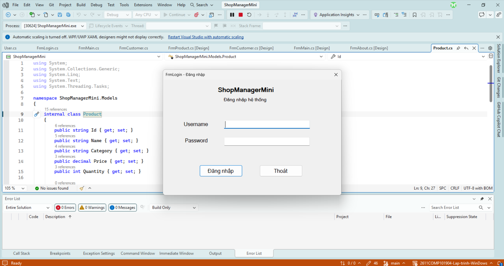

**Cảnh báo khi bỏ trống username/password**
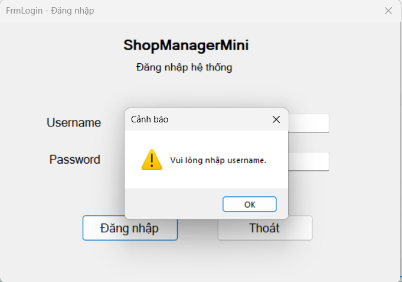

**Báo lỗi khi sai tài khoản hoặc mật khẩu**
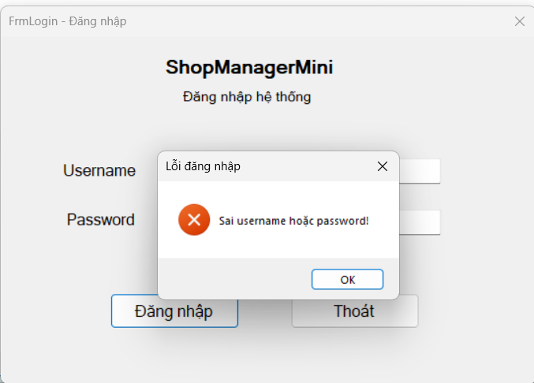

**Che mật khẩu**
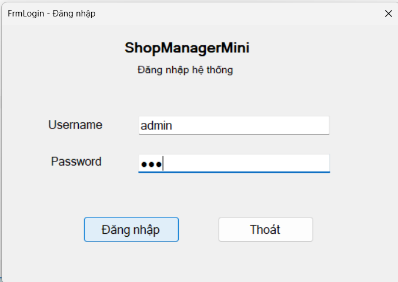

### 5.2. Form chính (MDI)

**FrmMain sau khi đăng nhập (thanh trạng thái có tên người dùng, vai trò, thời gian)**
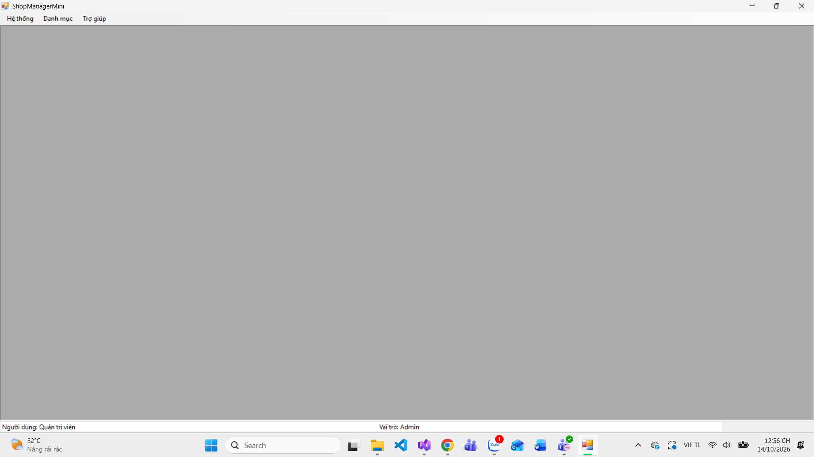

**Các menu (Hệ thống, Danh mục, Trợ giúp)**
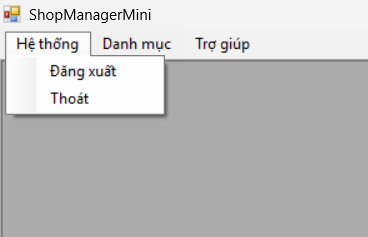
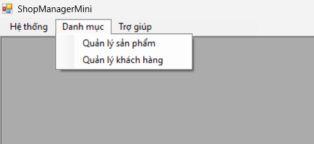
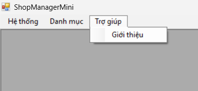

**Nhiều Form con mở bên trong FrmMain**
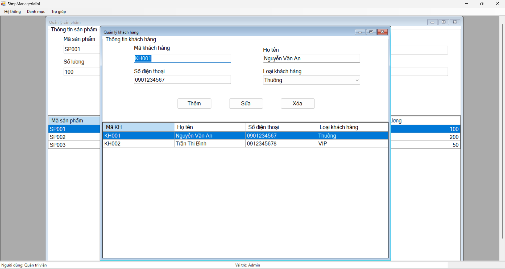

**Bấm menu nhiều lần vẫn chỉ có một Form (không mở trùng)**
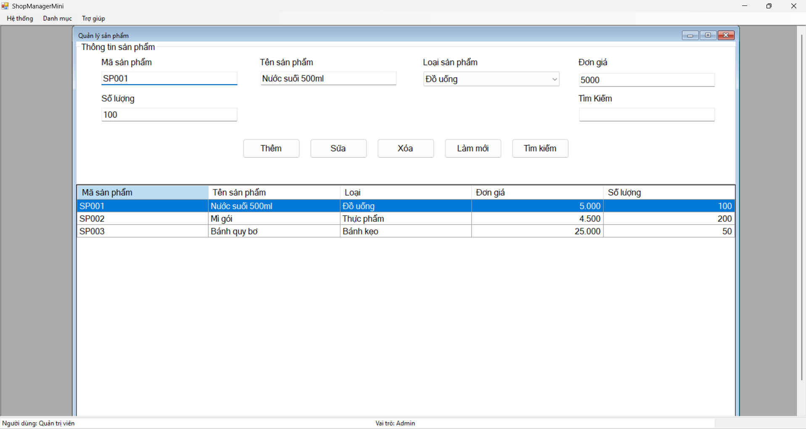

**Hỏi xác nhận khi thoát chương trình/đăng xuất**
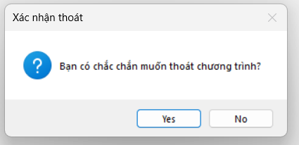
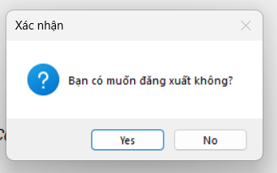

### 5.3. Quản lý sản phẩm

**Danh sách sản phẩm**
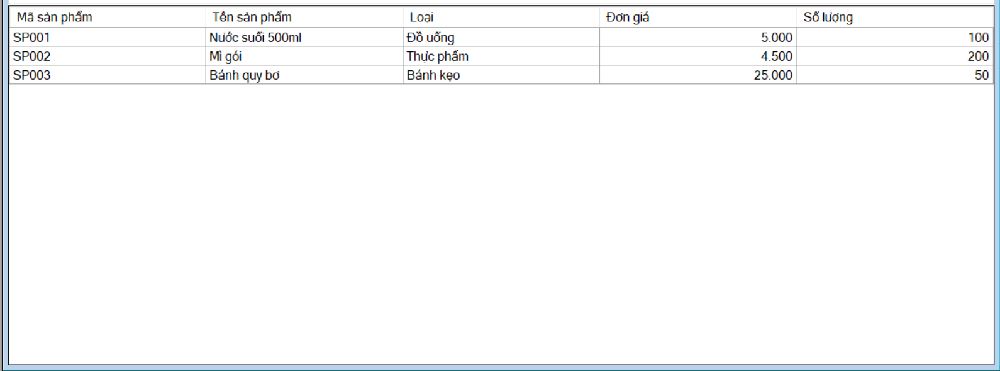

**Thêm sản phẩm thành công**
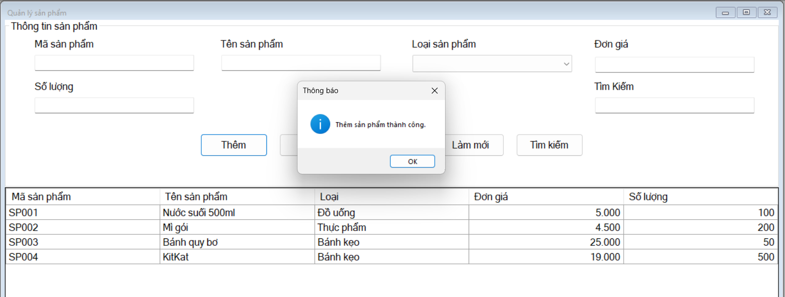

**Báo lỗi trùng mã sản phẩm**
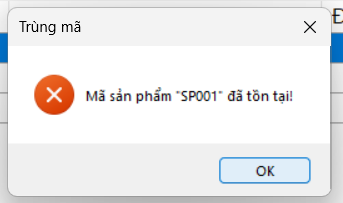

**Báo lỗi đơn giá hoặc số lượng âm**
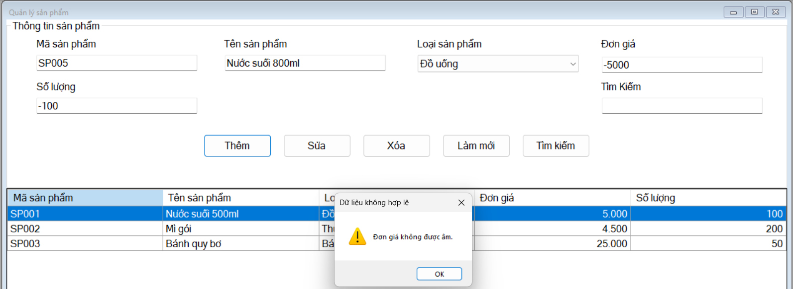

**Sửa sản phẩm**
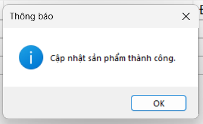

**Xác nhận trước khi xóa**
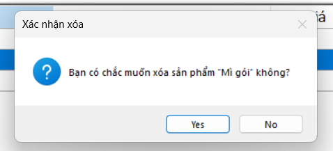

**Tìm kiếm sản phẩm**
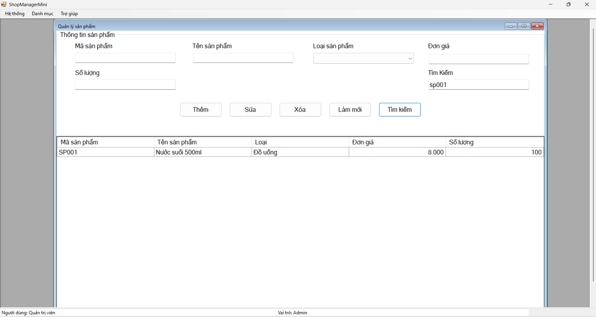

### 5.4. Quản lý khách hàng

**Danh sách và thêm khách hàng**
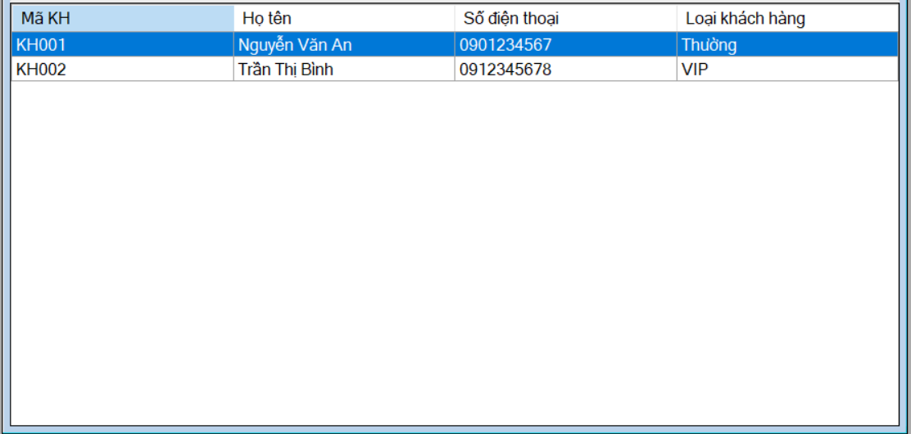
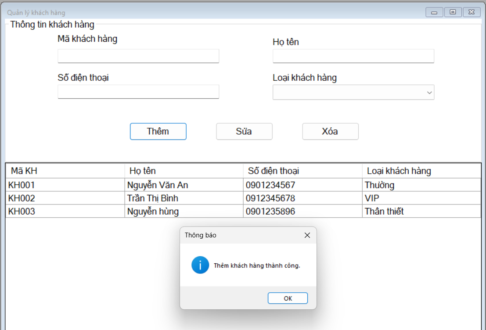


**Báo lỗi nhập sai (ví dụ số điện thoại không hợp lệ)**
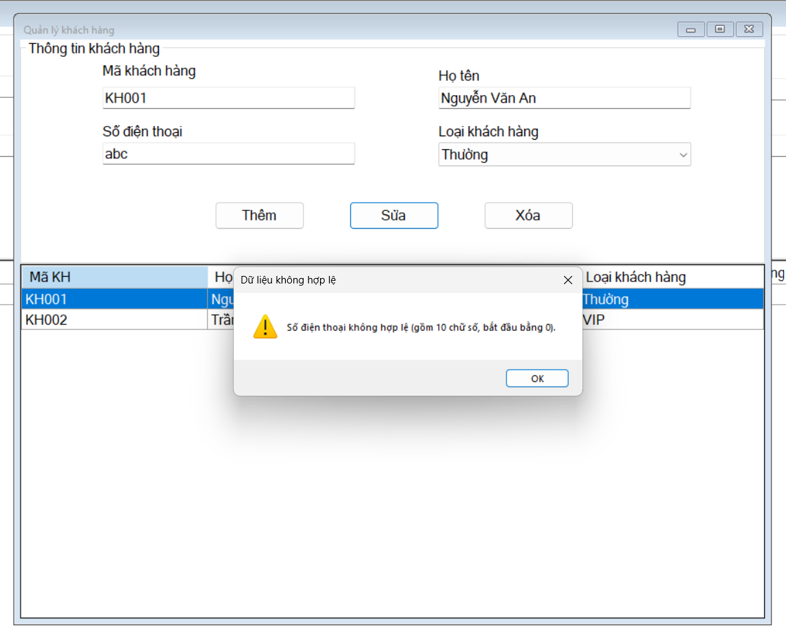

### 5.5. Giới thiệu

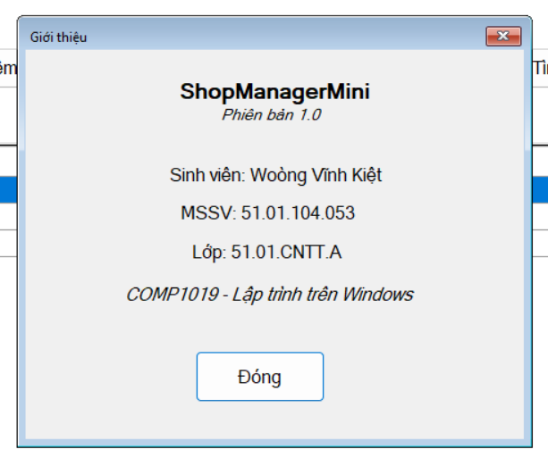

## 6. Trả lời câu hỏi

**1. SDI và MDI khác nhau như thế nào?**
SDI (Single Document Interface): mỗi cửa sổ là một Form độc lập, có thể nằm rời nhau trên màn hình. MDI (Multiple Document Interface): có một Form cha (`IsMdiContainer = true`) chứa nhiều Form con bên trong, các Form con không ra khỏi khung của Form cha và dùng chung menu của Form cha.

**2. Vì sao Form đăng nhập nên dùng `ShowDialog()`?**
`ShowDialog()` hiển thị Form dạng modal: chương trình dừng lại chờ người dùng xử lý xong Form đăng nhập mới chạy tiếp, người dùng không thể thao tác với Form khác khi chưa đăng nhập. Giá trị `DialogResult` trả về (OK/Cancel) cho biết đăng nhập thành công hay không để quyết định có mở Form chính hay không.

**3. Trong bài lab này, dữ liệu user được truyền từ FrmLogin sang FrmMain bằng cách nào?**
FrmLogin lưu user đăng nhập thành công vào property `LoggedInUser`. Sau khi `ShowDialog()` trả về OK, `Program` đọc property này rồi truyền sang FrmMain qua constructor: `new FrmMain(user)`. FrmMain dùng user đó để hiển thị tên và vai trò trên StatusStrip.

**4. Nếu người dùng bấm menu sản phẩm nhiều lần, chương trình xử lý như thế nào để không mở trùng Form?**
Hàm `OpenChildForm<T>()` duyệt qua `MdiChildren`. Nếu đã có Form cùng kiểu `T` thì không tạo mới mà khôi phục (nếu đang thu nhỏ) và gọi `Activate()` để đưa Form cũ lên trước. Chỉ khi chưa có mới tạo Form mới, gán `MdiParent = this` và `Show()`.

**5. Khi nào nên dùng constructor, khi nào nên dùng property để truyền dữ liệu giữa các Form?**
Dùng **constructor** khi dữ liệu là bắt buộc và cần có ngay từ lúc Form được tạo (ví dụ FrmMain cần `user`). Dùng **property** khi dữ liệu là tùy chọn, có thể gán sau khi tạo Form, hoặc khi cần đọc kết quả ra từ Form sau khi nó đóng (ví dụ `FrmLogin.LoggedInUser`).
