# Lab 10 - Thiết kế và cài đặt CSDL EduManagerDB (SQL Server)

## 1. Giới thiệu
CSDL `EduManagerDB` phục vụ ứng dụng quản lý sinh viên, gồm: khoa, lớp, sinh viên, môn học, kết quả học tập và tài khoản đăng nhập.

## 2. Các bảng và quan hệ
| Bảng | Khóa chính | Khóa ngoại | Ghi chú |
|---|---|---|---|
| KHOA | MaKhoa | - | Thông tin khoa |
| LOP | MaLop | MaKhoa -> KHOA | Mỗi lớp thuộc một khoa |
| SINHVIEN | MaSV | MaLop -> LOP | Mỗi sinh viên thuộc một lớp |
| MONHOC | MaMH | - | Thông tin môn học |
| KETQUA | (MaSV, MaMH) | MaSV -> SINHVIEN, MaMH -> MONHOC | Điểm theo môn |
| TAIKHOAN | TenDangNhap | - | Tài khoản demo |

## 3. Ràng buộc đã cài đặt
- `KETQUA.Diem` thuộc [0, 10] (CHECK).
- `SINHVIEN.GioiTinh` chỉ nhận `Nam` hoặc `Nữ` (CHECK).
- `MONHOC.SoTinChi` > 0 (CHECK).
- Khóa ngoại LOP->KHOA, SINHVIEN->LOP, KETQUA->SINHVIEN/MONHOC.
- Khóa chính ghép (MaSV, MaMH) ở KETQUA: không nhập trùng điểm.

## 4. Cách chạy
1. Chạy `01_CreateDatabase.sql` (tạo database và bảng).
2. Chạy `02_InsertSampleData.sql` (nhập dữ liệu mẫu).
3. Chạy `03_Queries.sql` (bôi đen và chạy từng câu).

## 5. Dữ liệu mẫu
2 khoa, 3 lớp, 7 sinh viên, 4 môn học, 8 kết quả, 2 tài khoản.

## 6. Kết quả kiểm thử
- Thêm sinh viên vào lớp `CNTT99` (không tồn tại): bị chặn bởi FOREIGN KEY.
- Nhập điểm 12: bị chặn bởi CHECK.

## 7. Ảnh chụp kết quả

### 6 bảng trong Object Explorer

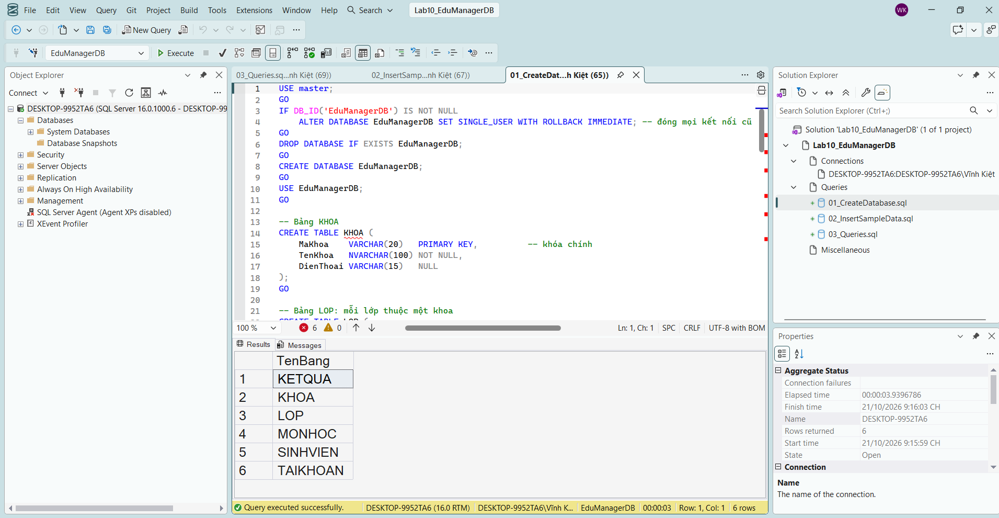

### Số dòng từng bảng

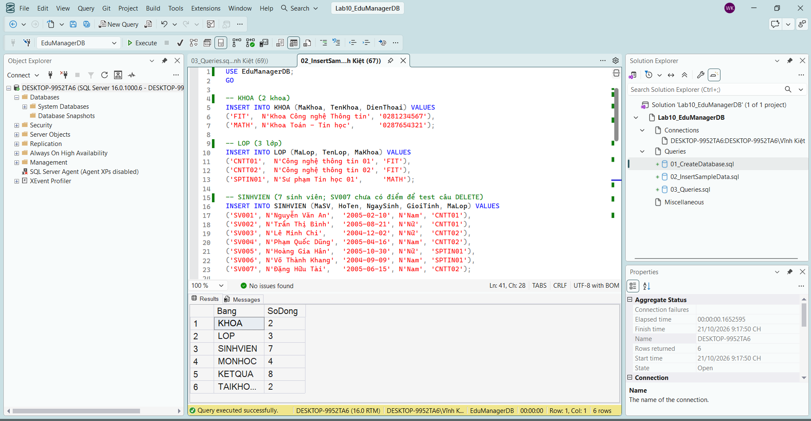

### 1. Toàn bộ sinh viên

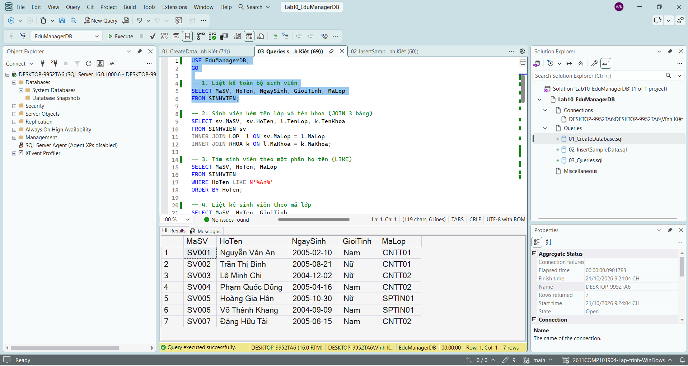

### 2. Liệt kê sinh viên kèm tên lớp và tên khoa

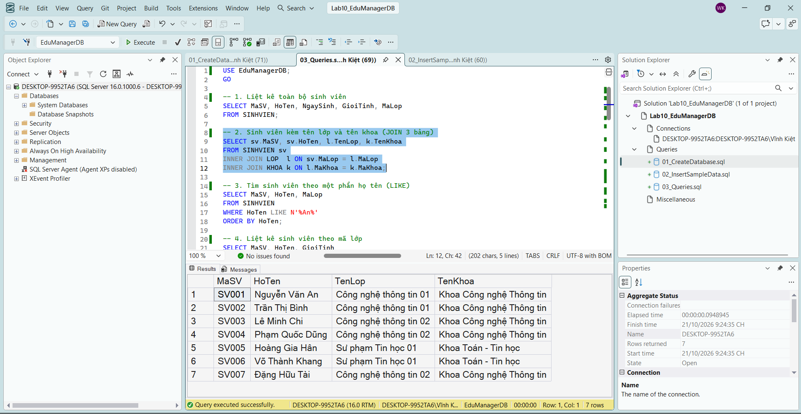

### 3. Tìm sinh viên theo một phần họ tên bằng LIKE

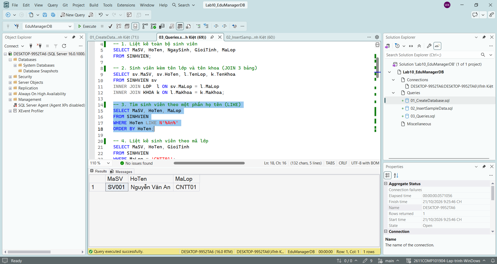

### 4. Liệt kê sinh viên theo mã lớp

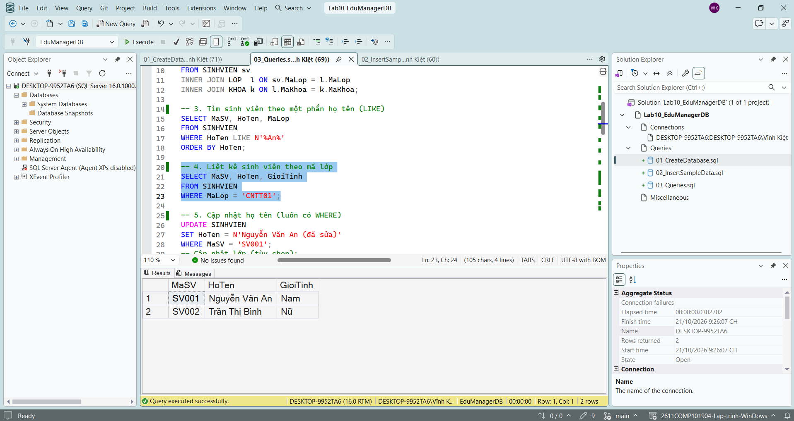

### 5. Cập nhật họ tên hoặc lớp của một sinh viên

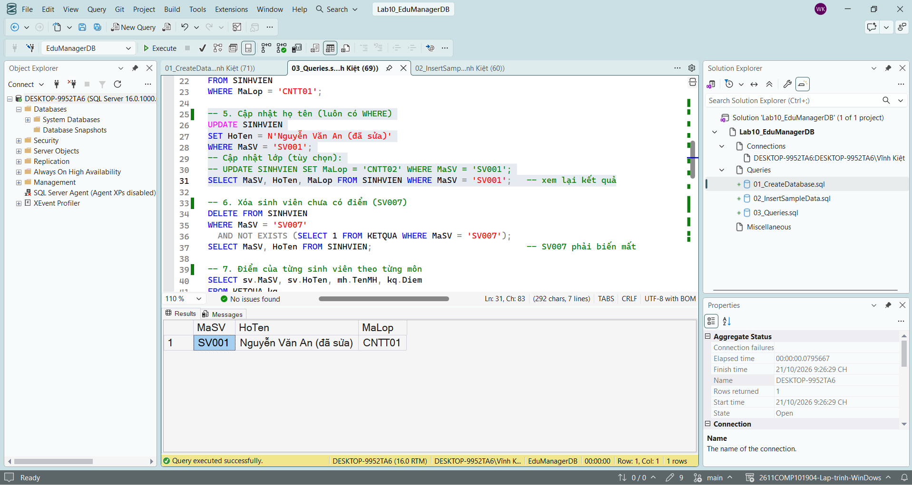

### 6. Xóa một sinh viên chưa có dữ liệu điểm

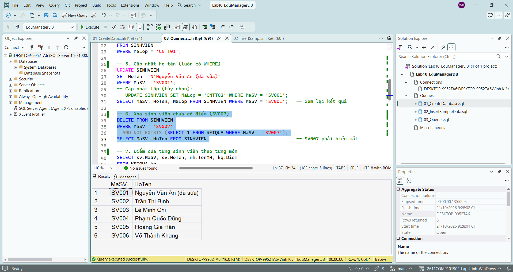

### 7. Liệt kê điểm của từng sinh viên theo từng môn

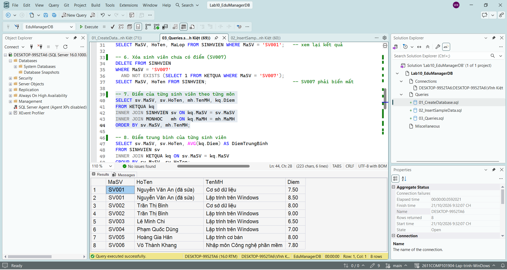

### 8. Tính điểm trung bình của từng sinh viên

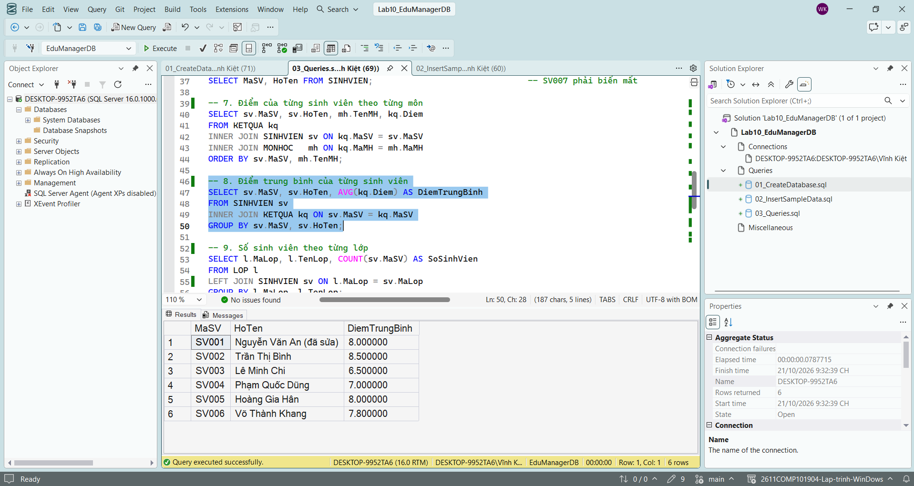

### 9. Thống kê số sinh viên theo từng lớp

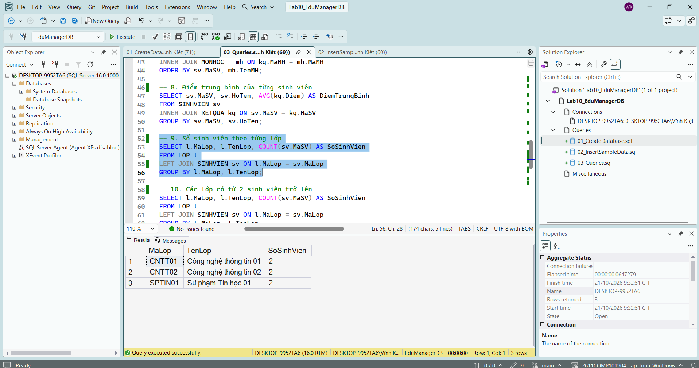

### 10. Liệt kê các lớp có từ 2 sinh viên trở lên

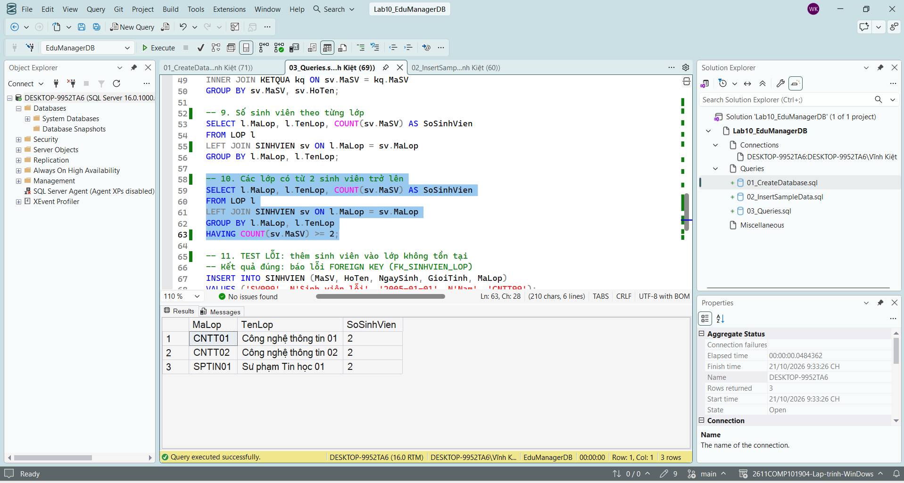

### 11. Test lỗi khi thêm sinh viên vào lớp không tồn tại

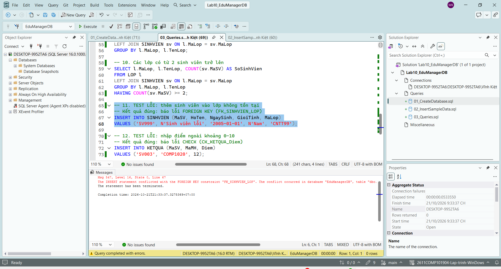

### 12. Test lỗi khi nhập điểm ngoài khoảng 0 đến 10

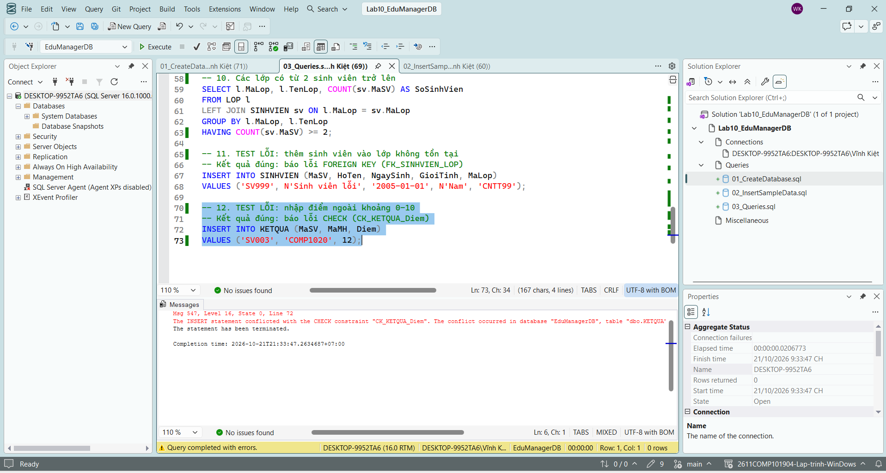
