# Lab 11 - ADO.NET và CRUD với SQL Server

Quản lý lớp học bằng Windows Forms (C#) kết nối SQL Server qua ADO.NET.

## 1. Giới thiệu

Ứng dụng cho phép xem, thêm, sửa, xóa và tìm kiếm lớp học. Dữ liệu lưu trong SQL Server (bảng `LOP`, `SINHVIEN`), không dùng `List<T>` để lưu tạm. Mọi câu SQL nhận dữ liệu từ người dùng đều dùng `SqlParameter`.

## 2. Công nghệ

- Visual Studio, Windows Forms App (C#, .NET Framework)
- SQL Server và SQL Server Management Studio (SSMS)
- Thư viện NuGet: `Microsoft.Data.SqlClient`

## 3. Cấu trúc thư mục

```
QuanLyLopHoc/
|-- QuanLyLopHoc/
|   |-- Program.cs
|   |-- FrmLop.cs
|   |-- FrmLop.Designer.cs
|-- EduManagerDB.sql        # script tạo database và dữ liệu mẫu
|-- images
|-- README.md
```

## 4. Hướng dẫn chạy

1. Mở SSMS, kết nối vào SQL Server của bạn.
2. Mở file `EduManagerDB.sql`, nhấn **Execute (F5)**. Script tạo database `EduManagerDB_Lab11` gồm 2 bảng `LOP`, `SINHVIEN` và dữ liệu mẫu (3 lớp, 2 sinh viên).
3. Mở solution bằng Visual Studio.
4. Cài package nếu chưa có: *Tools → NuGet Package Manager → Manage NuGet Packages* → cài `Microsoft.Data.SqlClient`.
5. Trong `FrmLop.cs`, kiểm tra biến `connectionString` (mục 5) cho đúng máy.
6. Nhấn **F5** để chạy.

## 5. Connection string đang sử dụng

```csharp
Data Source=.;Initial Catalog=EduManagerDB_Lab11;Integrated Security=True;TrustServerCertificate=True
```

- Dùng Windows Authentication, không có mật khẩu trong code.
- Nếu máy dùng SQL Server Express, đổi `Data Source=.` thành `Data Source=.\SQLEXPRESS`.
- `TrustServerCertificate=True` cần thiết vì `Microsoft.Data.SqlClient` mặc định bật mã hóa kết nối.

## 6. Cơ sở dữ liệu

```
LOP(MaLop PK, TenLop)
SINHVIEN(MaSV PK, HoTen, MaLop FK -> LOP.MaLop)
```

## 7. Chức năng

| Mã | Chức năng | Mô tả |
|---|---|---|
| F1 | Load dữ liệu | Khi mở Form, tự động tải danh sách lớp (kèm số sinh viên) lên `dgvLop` |
| F2 | Chọn dòng | Click một dòng thì mã lớp và tên lớp được đưa lên `txtMaLop`, `txtTenLop` |
| F3 | Thêm | Không cho thêm khi mã lớp hoặc tên lớp rỗng, hoặc mã lớp đã tồn tại |
| F4 | Sửa | Cập nhật tên lớp theo mã lớp đang chọn, không cho sửa nếu chưa chọn lớp |
| F5 | Xóa | Hỏi xác nhận, không cho xóa lớp đang có sinh viên, có bắt lỗi khóa ngoại |
| F6 | Tìm kiếm | Tìm theo mã hoặc tên lớp bằng `LIKE` kèm parameter |
| F7 | Làm mới | Xóa nội dung TextBox, mở khóa `txtMaLop`, tải lại dữ liệu |
| F8 | Bảo mật | Mọi câu SQL dùng `SqlParameter`, không nối chuỗi trực tiếp |

## 8. Kiểm thử nhanh

| STT | Tình huống | Dữ liệu | Kết quả mong đợi |
|---|---|---|---|
| 1 | Load Form | Mở ứng dụng | Hiển thị danh sách lớp |
| 2 | Thêm hợp lệ | `TEST01`, `Lớp test` | Thêm thành công |
| 3 | Thêm thiếu mã | Mã lớp rỗng | Cảnh báo nhập mã lớp |
| 4 | Thêm trùng mã | `CNTT01` | Cảnh báo mã lớp đã tồn tại |
| 5 | Sửa hợp lệ | Chọn `TEST01`, đổi tên | Cập nhật thành công |
| 6 | Sửa khi chưa chọn lớp | Không click dòng nào | Cảnh báo chọn lớp cần sửa |
| 7 | Xóa lớp chưa có sinh viên | `TEST01` | Hỏi xác nhận rồi xóa thành công |
| 8 | Xóa lớp đang có sinh viên | `CNTT01` | Không cho xóa |
| 9 | Tìm kiếm | `CNTT` | Hiển thị các lớp phù hợp |
| 10 | Làm mới | Bấm Làm mới | TextBox sạch, tải lại danh sách |

## 10. Xử lý sự cố

| Lỗi | Cách xử lý |
|---|---|
| Không kết nối được database | Kiểm tra `Data Source`, tên database và dịch vụ SQL Server đang chạy |
| Báo lỗi chứng chỉ SSL | Thêm `TrustServerCertificate=True` vào connection string |
| Lưới không hiện dữ liệu | Kiểm tra `(Name)` và `DataPropertyName` của 3 cột là `MaLop`, `TenLop`, `SoSinhVien` |
| Tiếng Việt bị lỗi font trong DB | Cột tên phải dùng `NVARCHAR` và chuỗi mẫu có tiền tố `N'...'` |

## 11. Ảnh chụp màn hình kiểm tra 
### Khởi chạy ứng dụng, dữ liệu từ SQL Server hiển thị đầy đủ lên `DataGridView`:

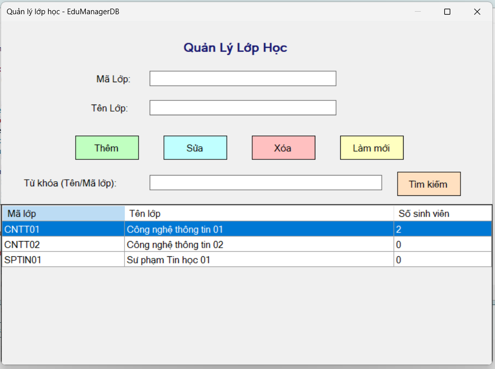

### Click dòng trên lưới, thông tin đổ lên TextBox và khóa trường mã lớp:

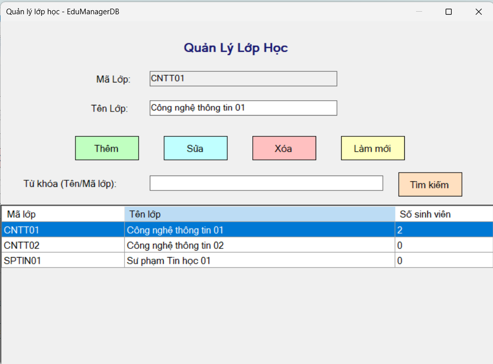

### Thêm lớp không hợp lệ (F3): để trống mã lớp thì báo cảnh báo, không thêm:

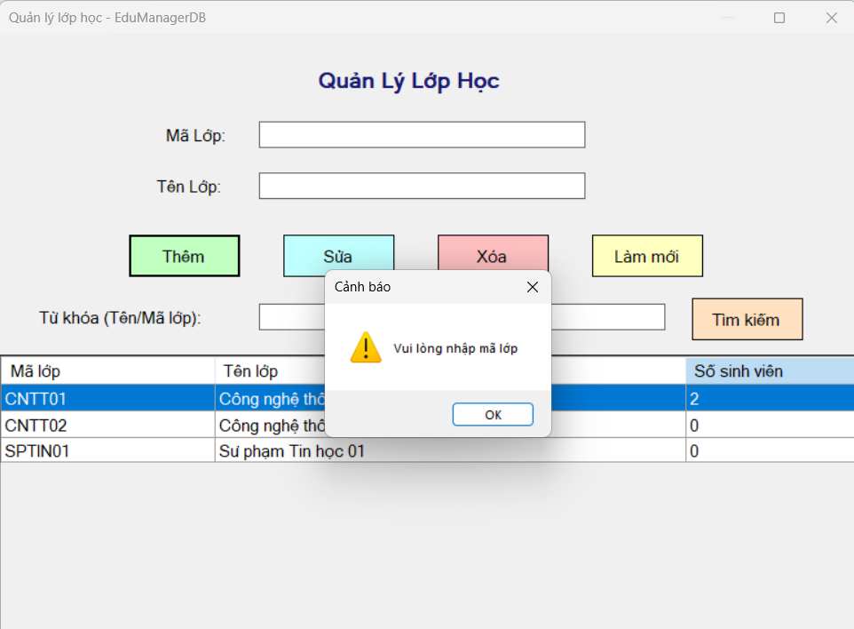

### Thêm lớp hợp lệ (F3): nhập `SPTIN02` và tên lớp, hệ thống báo thêm thành công:

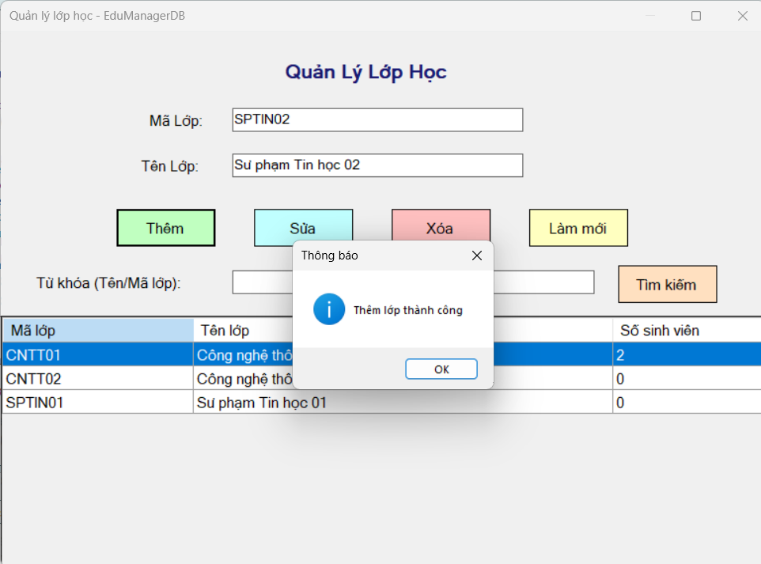

### Sau khi thêm: lưới tự tải lại, lớp mới xuất hiện và các ô nhập được làm trống:

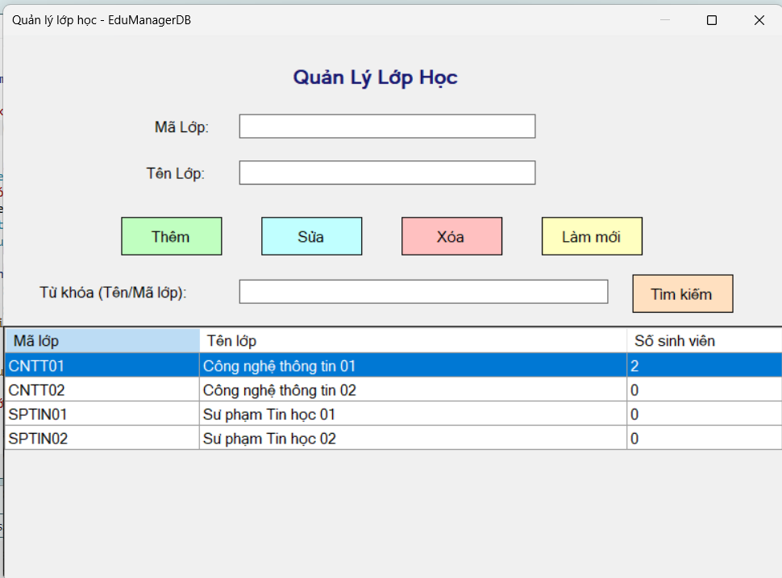

### Thêm trùng mã lớp (F3): nhập `CNTT01` đã tồn tại thì bị chặn:

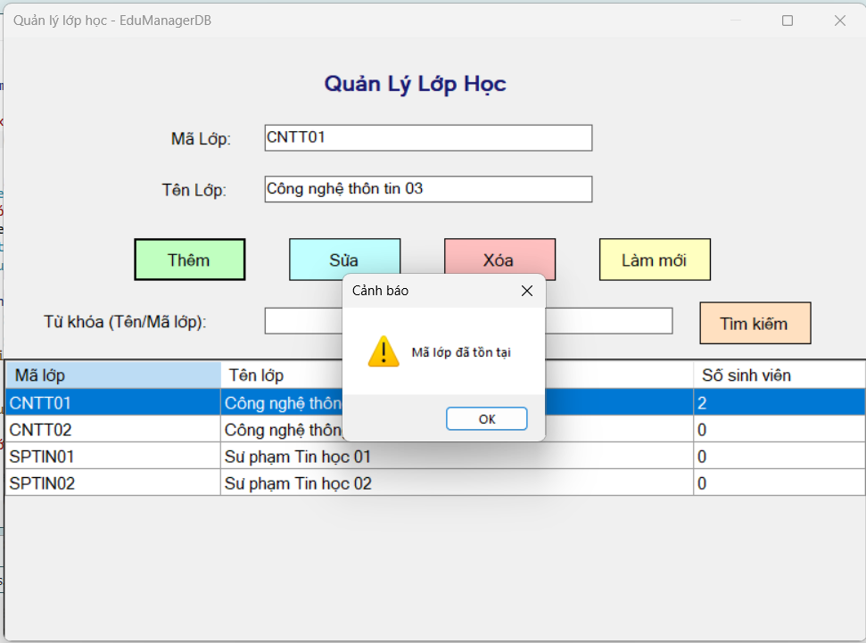

### Sửa khi chưa chọn lớp (F4): báo cảnh báo, không cho sửa:

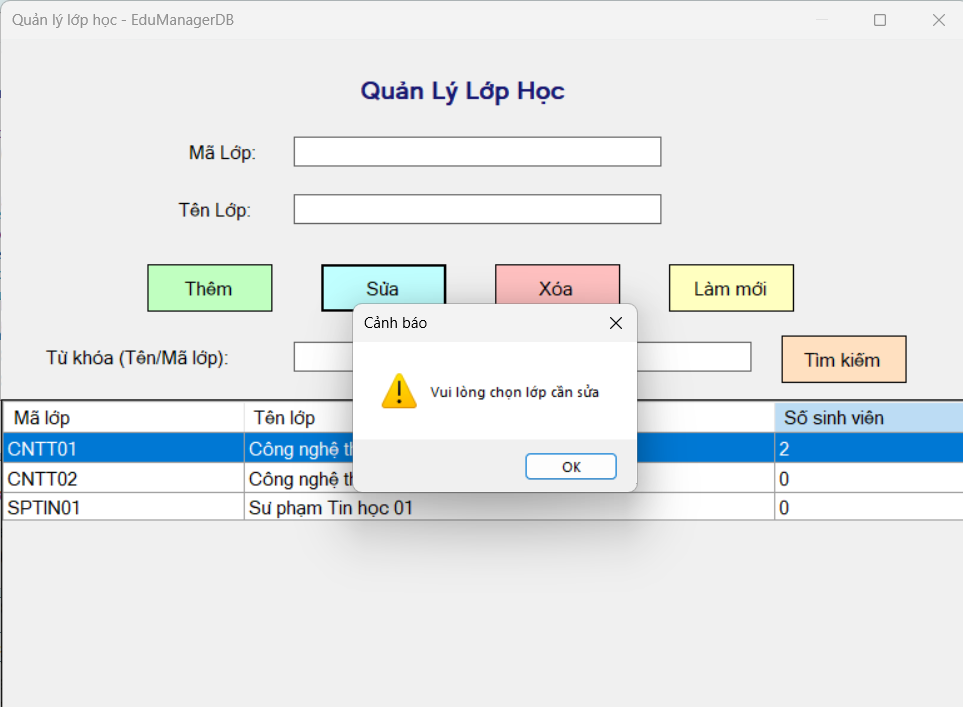

### Sửa lớp hợp lệ (F4): chọn `SPTIN01`, đổi tên lớp rồi bấm Sửa, mã lớp bị khóa nên không đổi được:

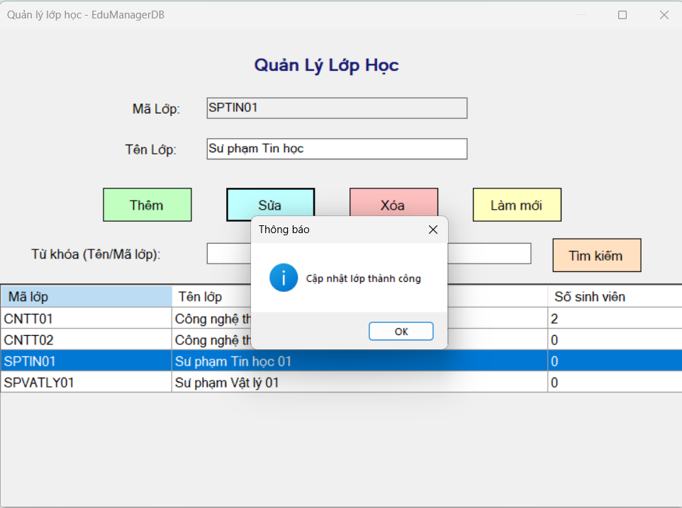

### Xóa khi chưa chọn lớp (F5): báo cảnh báo:

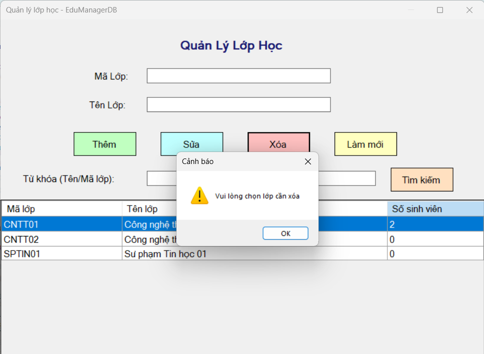

### Xóa lớp đang có sinh viên (F5): lớp `CNTT01` có 2 sinh viên nên không cho xóa:

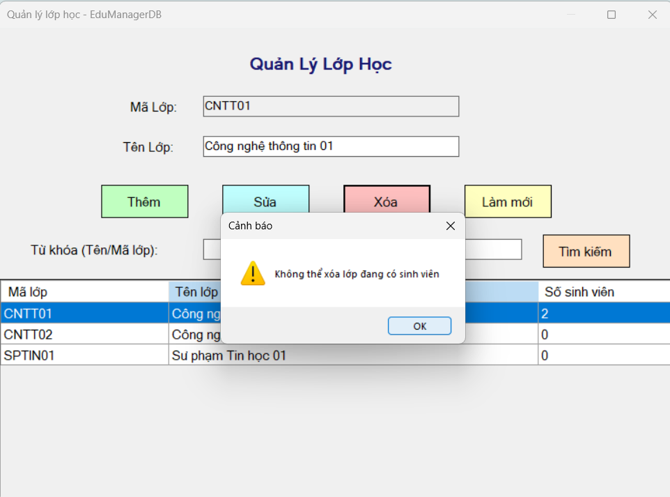

### Xóa lớp chưa có sinh viên (F5): hiện hộp thoại xác nhận trước khi xóa:

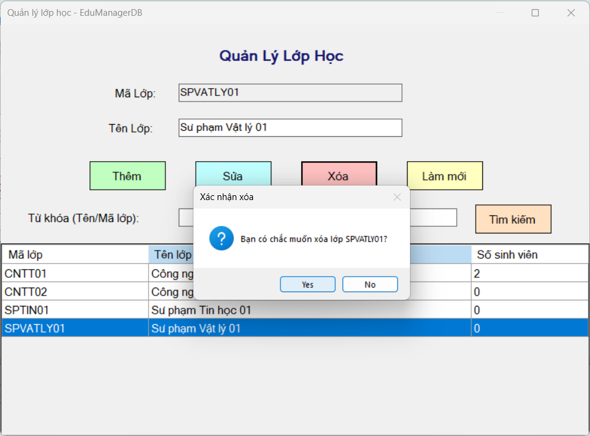

### Tìm kiếm (F6): gõ từ khóa `ly`, lưới chỉ hiện lớp có mã hoặc tên chứa từ khóa:

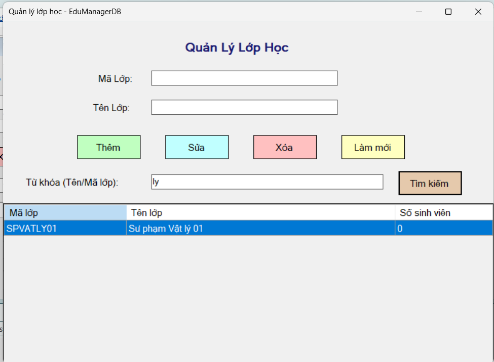


