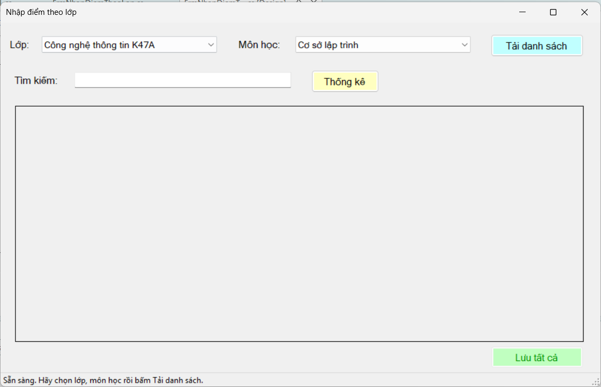
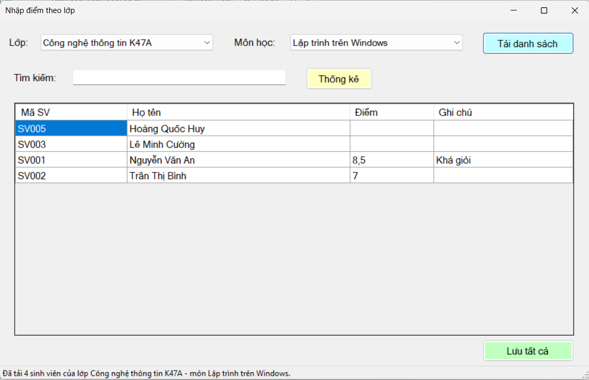
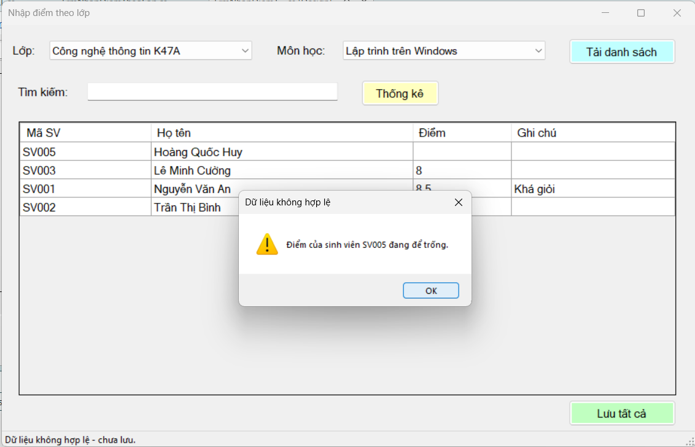
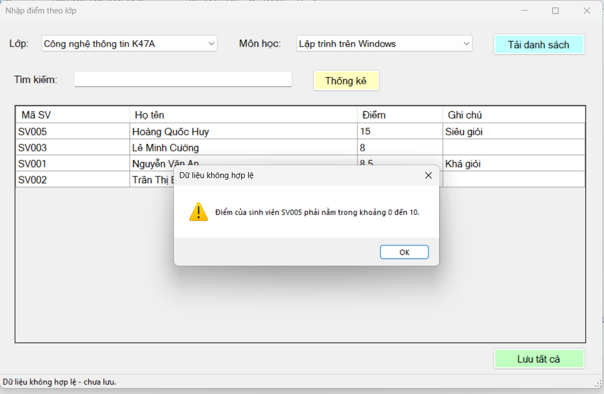
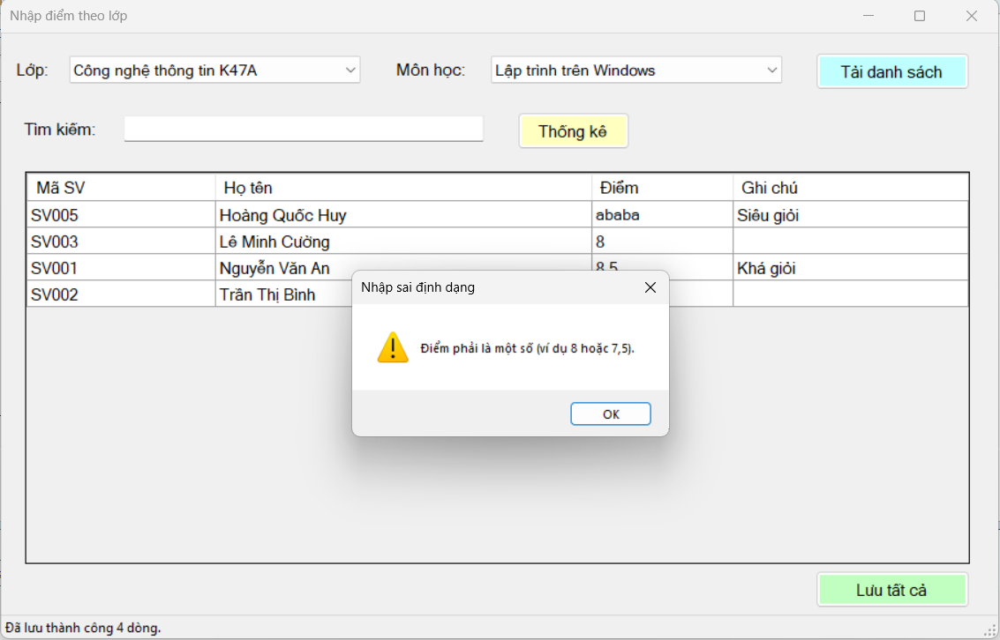
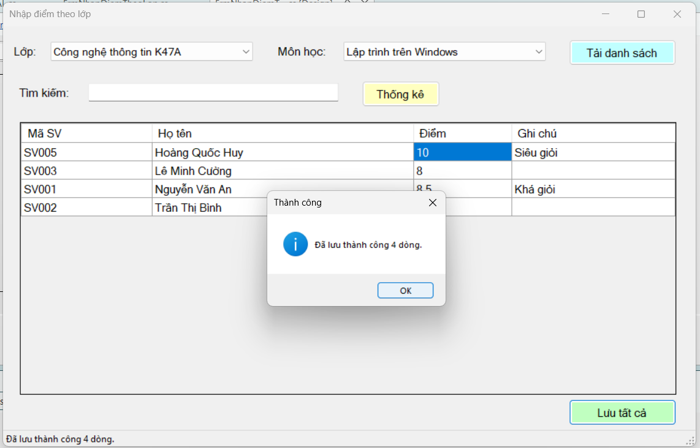
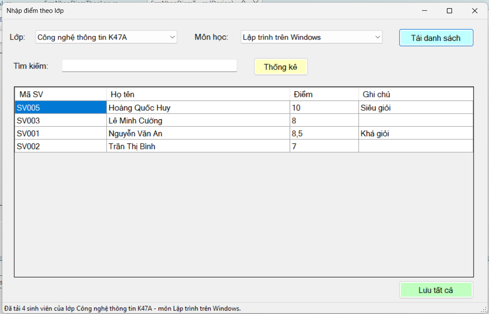
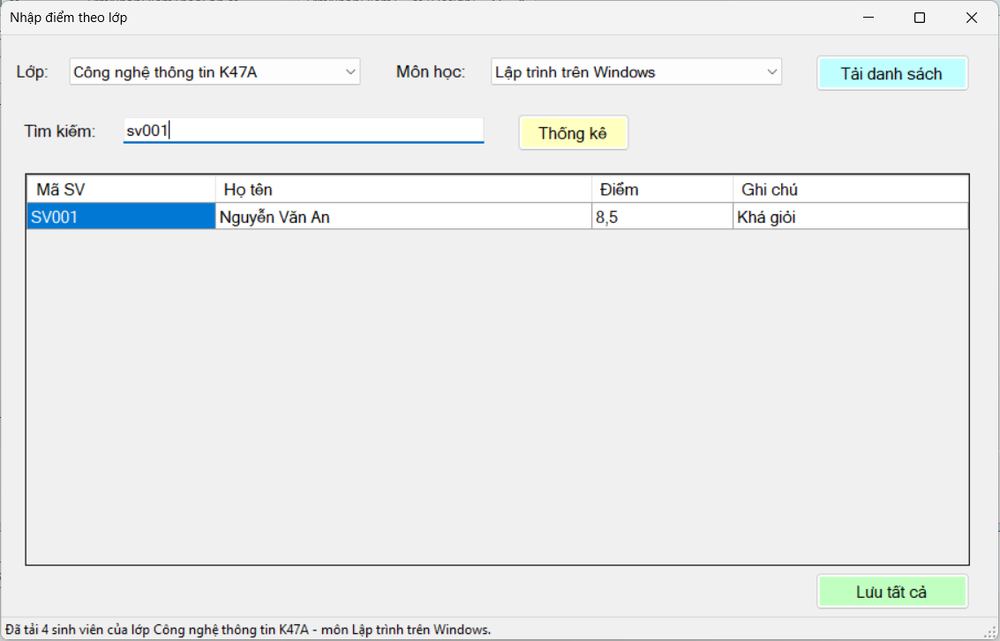
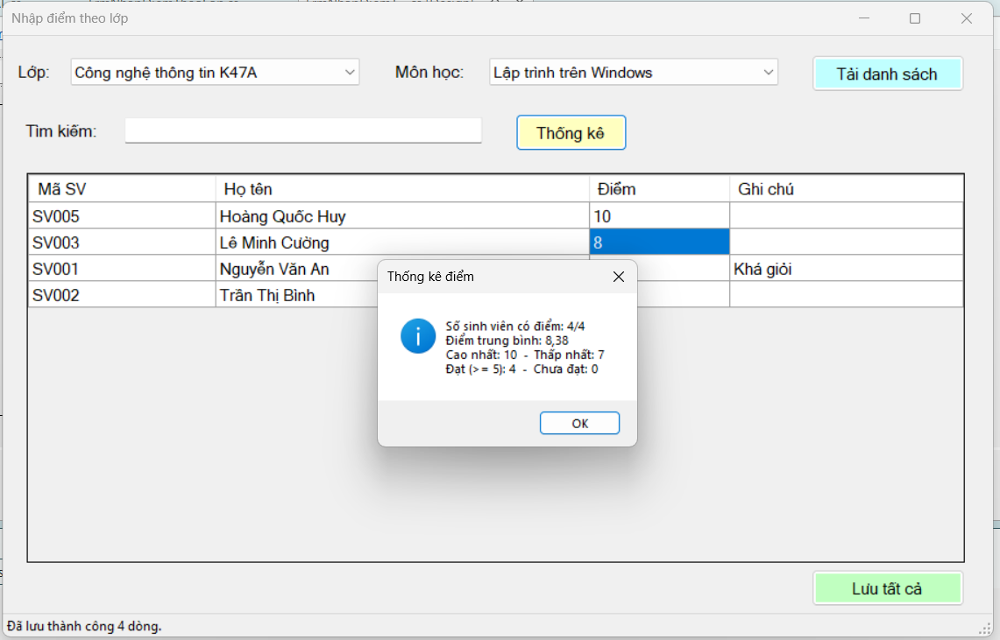
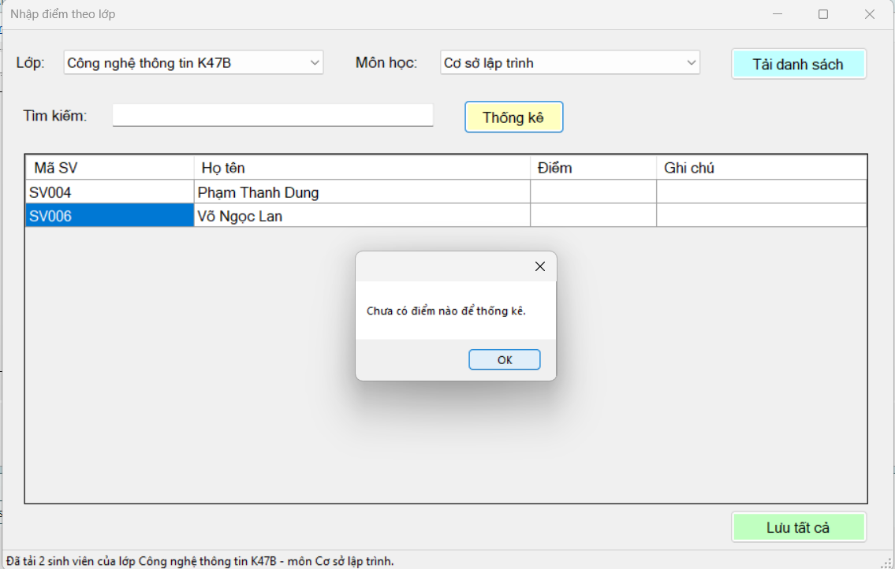

# Lab 12 - Quản lý kết quả học tập (Data Binding, Stored Procedure, Transaction)

Học phần COMP1019 - Lập trình trên Windows | C# WinForms, SQL Server, ADO.NET, Microsoft.Data.SqlClient

## Cấu trúc
```
QLSinhVienLab12
├── Forms/FrmNhapDiemTheoLop.cs      (+ .Designer.cs do Visual Studio tạo khi kéo control)
├── DAL/Database.cs                  (connection string)
├── DAL/KetQuaDAL.cs                 (truy cập DB, transaction)
├── Database/QLSinhVienLab12.sql     (tạo DB, bảng, dữ liệu mẫu, 4 stored procedure)
└── Images/                          (ảnh thiết kế form, ảnh chụp trước/sau khi lưu)
```

## Cách chạy (.NET Framework 4.7.2 trở lên)
1. Mở SSMS, chạy `Database/QLSinhVienLab12.sql`.
2. Tạo project **Windows Forms App (.NET Framework)** tên `QLSinhVienLab12`.
3. NuGet: cài `Microsoft.Data.SqlClient`.
4. Tạo thư mục `Forms`, `DAL`; thêm các file `.cs` tương ứng. Tạo Form `FrmNhapDiemTheoLop` trong thư mục `Forms`, dựng giao diện theo `Images/Form_FrmNhapDiemTheoLop_ThietKe.png`.
5. Sửa `Database.ConnectionString` nếu dùng SQLEXPRESS (`Data Source=.\SQLEXPRESS`).
6. Trong `Program.cs`: `Application.Run(new Forms.FrmNhapDiemTheoLop());`

## Gắn sự kiện (Events trong Properties)
| Control | Event | Hàm |
|---|---|---|
| Form | Load | FrmNhapDiemTheoLop_Load |
| btnTaiDanhSach | Click | btnTaiDanhSach_Click |
| btnLuuTatCa | Click | btnLuuTatCa_Click |
| dgvKetQua | DataError | dgvKetQua_DataError |
| txtTimKiem | TextChanged | txtTimKiem_TextChanged |
| btnThongKe | Click | btnThongKe_Click |

## Kỹ thuật sử dụng
- `DataTable` + `SqlDataAdapter` lấy dữ liệu qua stored procedure; `BindingSource` làm cầu nối cho `DataGridView`; ComboBox bind bằng `DataSource/DisplayMember/ValueMember`.
- Mọi lệnh SQL dùng `SqlParameter`, không nối chuỗi.
- `SaveAll` mở **một transaction**, gọi `sp_KetQua_Save` cho từng dòng, **commit một lần sau vòng lặp**, `catch` thì **rollback** rồi ném lỗi lên Form.
- Validate trước khi lưu: điểm không rỗng, là số, trong [0, 10]; chọn lại đúng ô lỗi.
- Mở rộng: tìm kiếm theo tên/MSSV (`BindingSource.Filter`), nút Thống kê (TB, cao/thấp nhất, đạt/chưa đạt).

## Ảnh chụp màn hình kiểm thử

### Mở Form: ComboBox tự load danh sách lớp và môn học từ stored procedure, lưới còn trống, nút Lưu tất cả bị khóa:


### Tải danh sách (trước khi lưu): chọn lớp `CTK47A`, môn `Lập trình trên Windows`, bấm Tải danh sách. Sinh viên đã có điểm hiện sẵn (SV001 = 8,5; SV002 = 7), sinh viên chưa có điểm để trống:


### Lưu khi để trống điểm: bỏ trống điểm của một sinh viên rồi bấm Lưu tất cả, hệ thống báo cảnh báo, chọn đúng ô lỗi và không lưu gì:


### Lưu khi điểm ngoài khoảng 0 đến 10: nhập `15` rồi bấm Lưu tất cả, hệ thống báo điểm phải từ 0 đến 10, không lưu:


### Nhập điểm không phải số: gõ `abc` vào cột Điểm, hệ thống báo điểm phải là một số:


### Lưu hợp lệ (transaction): nhập đủ điểm hợp lệ cho cả lớp, bấm Lưu tất cả, hệ thống commit và báo số dòng đã lưu:


### Sau khi lưu: tải lại danh sách thì điểm vừa nhập vẫn còn, đồng thời bảng `KETQUA` trong SSMS có đủ dòng dữ liệu (dòng cũ được UPDATE, dòng mới được INSERT):


### Tìm kiếm (mở rộng): gõ tên hoặc mã sinh viên vào ô tìm kiếm, lưới chỉ hiện các dòng phù hợp:


### Thống kê (mở rộng): bấm Thống kê, hệ thống hiện số sinh viên có điểm, điểm trung bình, cao nhất, thấp nhất, số đạt và chưa đạt:




## Khác biệt nhỏ so với lời giải mẫu (có chủ đích)
- `sp_KetQua_GetByLopMon` trả `Diem = NULL` cho sinh viên chưa có điểm (mẫu trả 0) để yêu cầu "điểm không được rỗng" thực sự có tác dụng.
- Có thêm `THROW` trong `sp_KetQua_Save` để kiểm tra điểm ngay ở DB.
- Dùng `SqlParameter` có kiểu rõ ràng thay vì `AddWithValue`.
