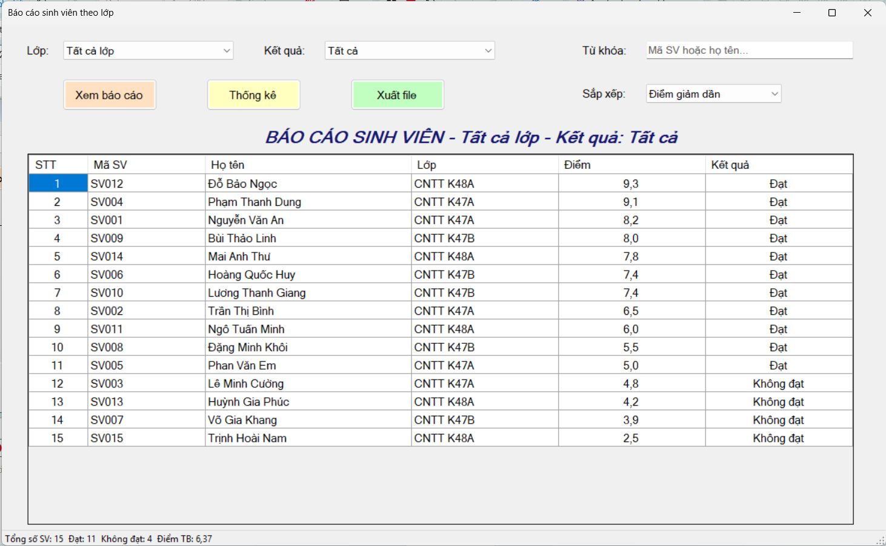
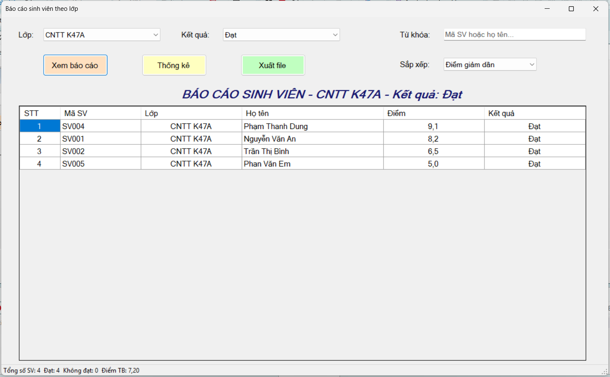
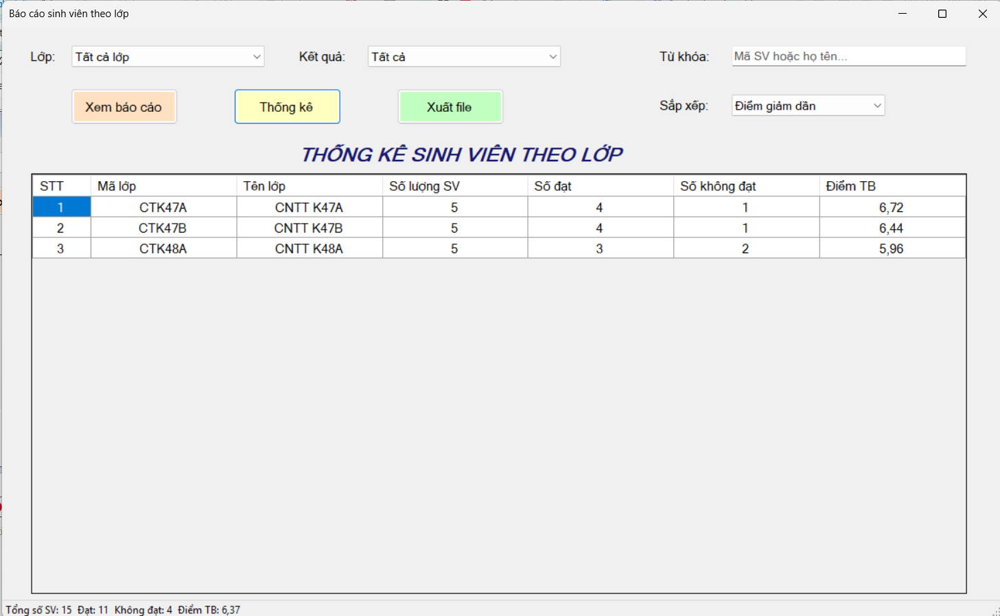
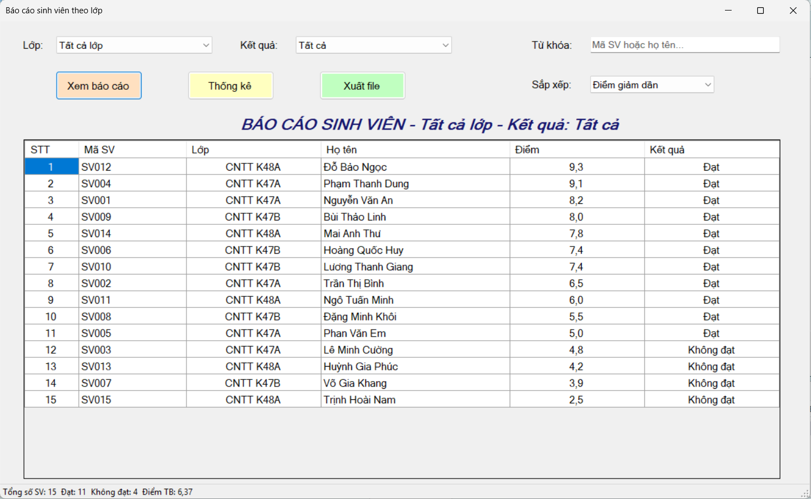
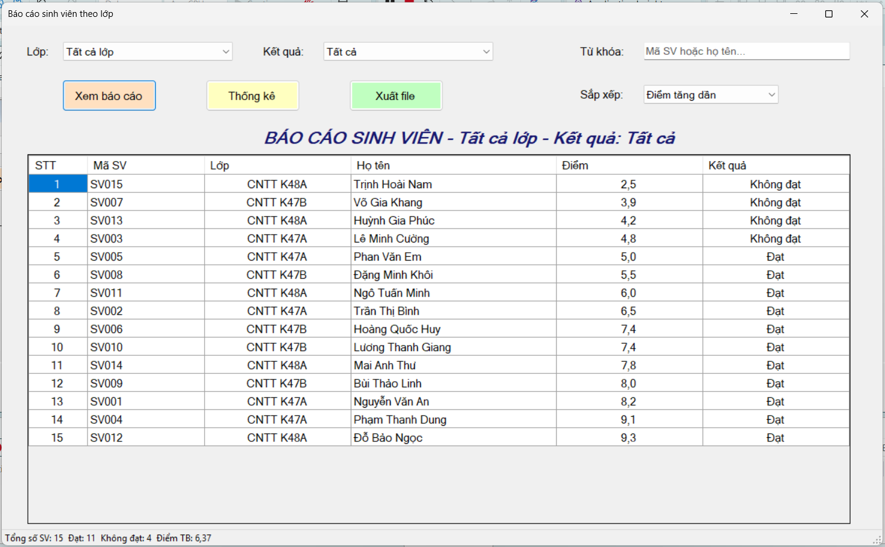
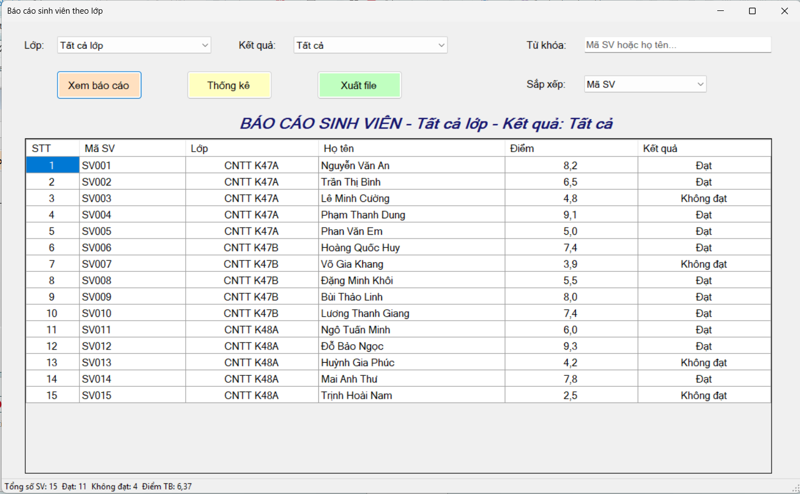
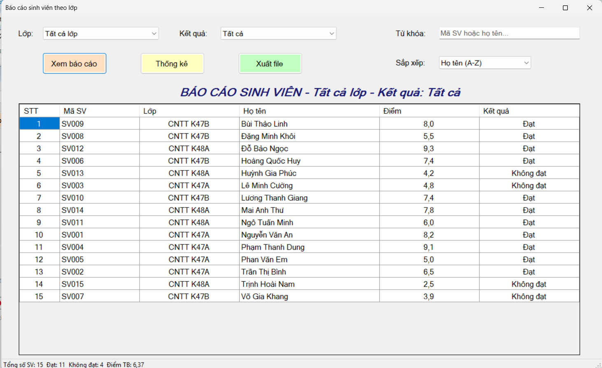
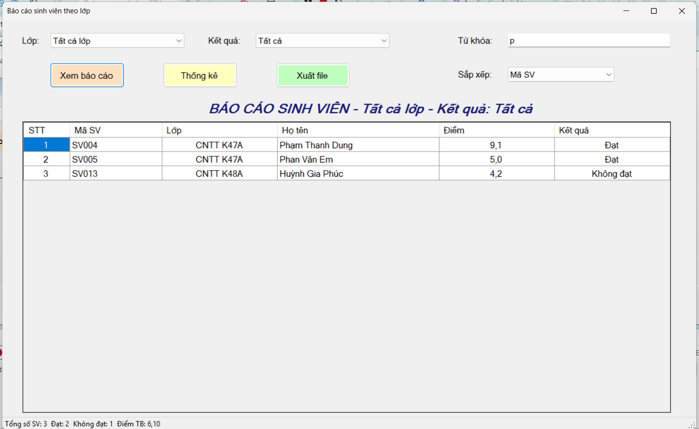
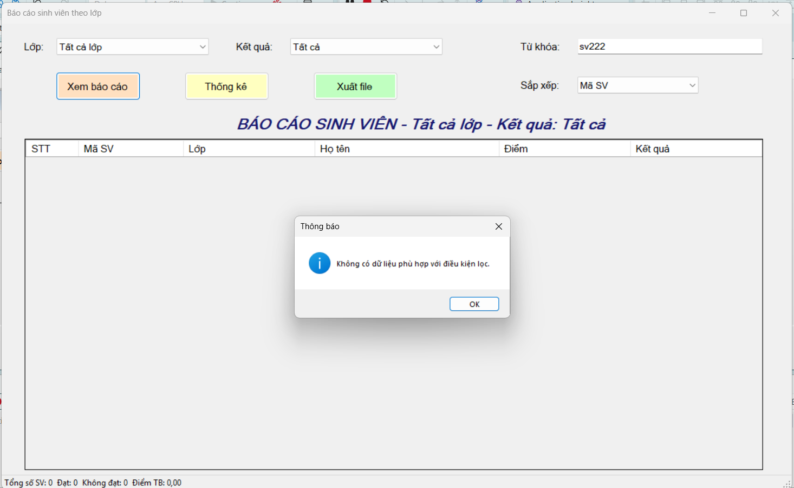
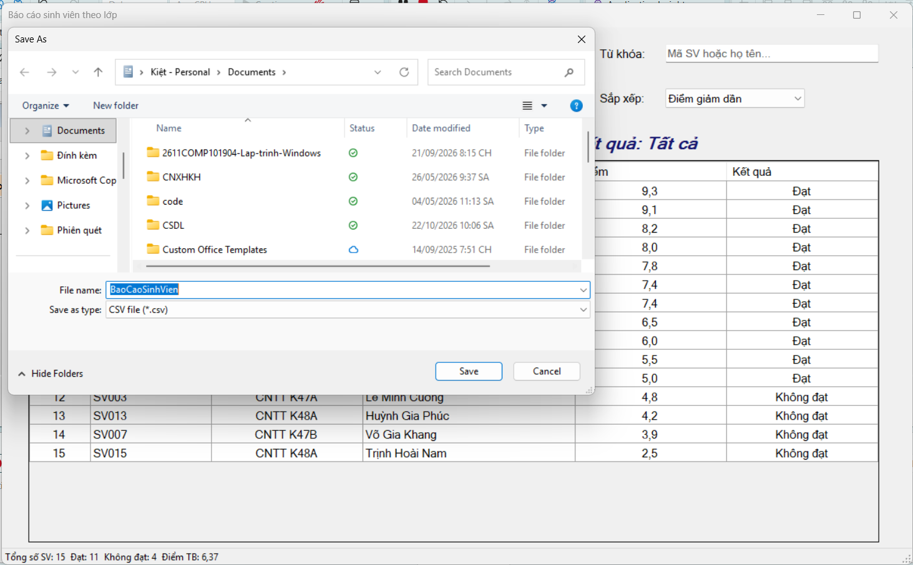

# Lab 13 – Báo cáo sinh viên bằng LINQ

**Học phần:** COMP1019 – Lập trình trên Windows
**Trường:** Đại học Sư phạm TP. Hồ Chí Minh – Khoa Công nghệ Thông tin
**Công nghệ:** C# WinForms, LINQ, DataGridView, StatusStrip, SaveFileDialog

## 1. Mục tiêu

- Củng cố kỹ năng xử lý dữ liệu bằng LINQ trong C#.
- Thiết kế Form báo cáo dữ liệu trong WinForms.
- Dùng DataGridView để hiển thị kết quả lọc và thống kê.
- Xuất dữ liệu báo cáo ra file CSV hoặc TXT.

## 2. Mô tả bài toán

Module **Báo cáo danh sách sinh viên theo lớp**: người dùng chọn lớp, kết quả học tập, từ khóa tìm kiếm và kiểu sắp xếp, sau đó bấm **Xem báo cáo**. Chương trình dùng LINQ để lọc, sắp xếp, thống kê và hiển thị dữ liệu. Kết quả có thể xuất ra file CSV hoặc TXT.

## 3. Cấu trúc project

```
StudentReportDemo
│
├── Models
│   └── SinhVien.cs
│
├── Forms
│   ├── FrmBaoCaoSinhVien.cs
│   └── FrmBaoCaoSinhVien.Designer.cs
│
├── screenshots
│   ├── mo_form.png
│   ├── loc_du_lieu.png
│   ├── thong_ke.png
│   ├── sap_xep1.png
│   ├── sap_xep2.png
│   ├── sap_xep3.png
|   ├── sap_xep4.png
│   ├── tim_kiem1.png
|   ├── tim_kiem2.png
│   └── xuat_file.png
│
├── output
│   └── BaoCaoSinhVien.csv
│
├── Program.cs
└── README.md
```

## 4. Thiết kế giao diện

Form `FrmBaoCaoSinhVien` gồm các control:

| Control | Loại | Chức năng |
|---|---|---|
| `cboLop` | ComboBox | Chọn lớp (có mục "Tất cả lớp") |
| `cboKetQua` | ComboBox | Chọn Tất cả / Đạt / Không đạt |
| `txtTuKhoa` | TextBox | Tìm theo mã SV hoặc họ tên |
| `cboSapXep` | ComboBox | Chọn kiểu sắp xếp |
| `btnXemBaoCao` | Button | Lọc và hiển thị báo cáo |
| `btnThongKe` | Button | Thống kê theo lớp |
| `btnXuatFile` | Button | Xuất dữ liệu đang hiển thị ra file |
| `lblTieuDe` | Label | Tiêu đề báo cáo theo điều kiện lọc |
| `dgvBaoCao` | DataGridView | Hiển thị kết quả |
| `stsThongKe` | StatusStrip | Tổng SV, số đạt, số không đạt, điểm TB |

## 5. Model dữ liệu

Lớp `SinhVien` gồm: `MaSV`, `HoTen`, `MaLop`, `TenLop`, `Diem` và thuộc tính chỉ đọc `KetQua` (trả về **"Đạt"** nếu `Diem >= 5`, ngược lại **"Không đạt"**).

Dữ liệu mẫu gồm **15 sinh viên** thuộc **3 lớp**: CNTT K47A, CNTT K47B, CNTT K48A.

## 6. Các chức năng và LINQ sử dụng

| Chức năng | Hàm xử lý | LINQ sử dụng |
|---|---|---|
| Tạo dữ liệu mẫu | `TaoDuLieuMau()` | – |
| Nạp ComboBox | `LoadComboBox()` | `Select`, `Distinct`, `OrderBy`, `Concat` |
| Xem báo cáo | `XemBaoCao()` / `LocDuLieu()` | `Where`, `OrderByDescending`, `ThenBy`, `Select` |
| Thống kê trên StatusStrip | `CapNhatThongKe()` | `Count`, `Average` |
| Thống kê theo lớp | `ThongKeTheoLop()` | `GroupBy`, `Count`, `Average`, `OrderBy` |
| Xuất file CSV / TXT | `XuatFile()` | `Select`, `Where`, `Cast` |

Điểm nổi bật:

- Lọc kết hợp 3 điều kiện: lớp, kết quả học tập, từ khóa (không phân biệt hoa thường).
- Sắp xếp mặc định theo **điểm giảm dần**; có thể đổi sang điểm tăng dần, họ tên A-Z, mã SV.
- Dòng **"Không đạt"** hiển thị chữ màu đỏ; có cột **STT**.
- Khi không có dữ liệu phù hợp, chương trình hiện thông báo rõ ràng.
- Xuất file có xử lý ngoại lệ (file đang mở, không có quyền ghi, lỗi khác) và xử lý dấu phẩy trong dữ liệu CSV.
- File CSV lưu UTF-8 có BOM nên Excel mở được tiếng Việt.

## 7. Hình ảnh minh họa

### Màn hình khi mở Form



### Lọc dữ liệu theo lớp và kết quả



### Thống kê 



### Sắp xếp 









### Tìm kiếm





### 7.5. Xuất file báo cáo



File báo cáo đã xuất: [`output/BaoCaoSinhVien.csv`](output/BaoCaoSinhVien.csv)

## 8. Hướng dẫn chạy chương trình

1. Cài **Visual Studio** (workload *.NET desktop development*).
2. Clone repository về máy:
   ```bash
   git clone <đường-dẫn-repository>
   ```
3. Mở file `StudentReportDemo.sln` (hoặc `.csproj`) bằng Visual Studio.
4. Nhấn **F5** để chạy.

## 9. Kết quả đạt được

- Thiết kế Form đúng yêu cầu, đặt tên control rõ ràng.
- Dùng LINQ để lọc, sắp xếp, chọn dữ liệu, nhóm và thống kê.
- Hiển thị báo cáo trên DataGridView và StatusStrip.
- Xuất được file CSV/TXT, có kiểm tra dữ liệu, thông báo lỗi và tách hàm rõ ràng.

## 10. Tài liệu tham khảo

- Tài liệu học phần COMP1019 – Lập trình trên Windows.
- Microsoft Docs: [LINQ](https://learn.microsoft.com/dotnet/csharp/linq/), [DataGridView](https://learn.microsoft.com/dotnet/desktop/winforms/controls/datagridview-control-windows-forms).
